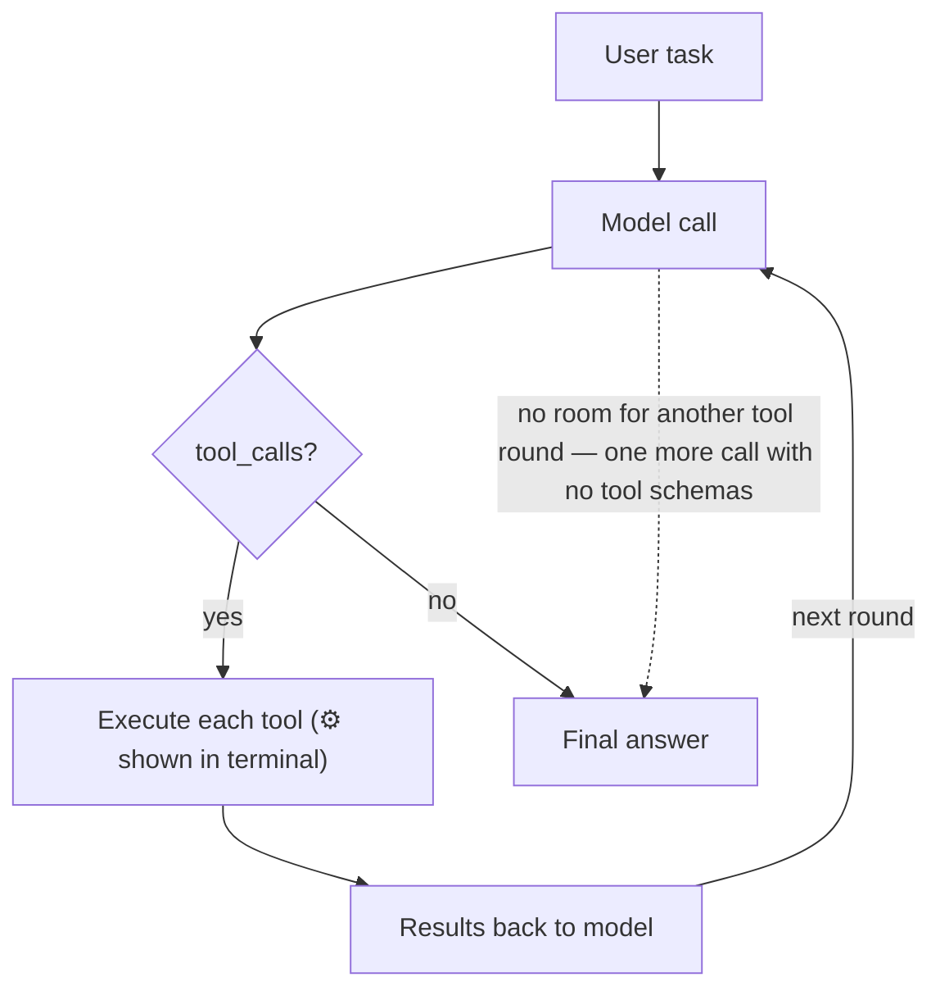

# letsClaw — Low Energy Technical Support Agent Engine

A stripped-down agent: a long-lived **core service** holding the conversations, and
thin clients — a terminal REPL, a browser UI and a Discord bot — that attach to it
over a WebSocket. Behavior is plain MD files — everything visible, nothing hidden.

## Contents

<!-- Generated list, and pinned: tests/test_doc_pointers.py fails if a
     heading is added, renamed or removed without its line here. -->

- [Philosophy / features](#philosophy--features)
- [Quick Start](#quick-start)
- [What using it looks like](#what-using-it-looks-like)
- [Architecture](#architecture)
- [Terminology](#terminology)
- [The behavior files](#the-behavior-files)
- [The tools](#the-tools)
- [Context: rollover, digest, journal](#context-rollover-digest-journal)
- [Reasoning: the Notepad and the Answer Sheet](#reasoning-the-notepad-and-the-answer-sheet)
- [Token Counting](#token-counting)
- [The Core](#the-core)
  - [Reloading config](#reloading-config)
  - [`/restart` — for the keys reload cannot reach](#restart--for-the-keys-reload-cannot-reach)
- [Security](#security)
- [Commands you can type](#commands-you-can-type)
- [Terminal Client](#terminal-client)
- [WebUI](#webui)
- [Discord Client](#discord-client)
- [Installing as a service](#installing-as-a-service)
- [Future Features](#future-features)
- [Config](#config)
- [Where the detail lives](#where-the-detail-lives)

## Philosophy / features

**The principles**

- **Simple** — one config file, MD files for behavior. No DSL, no plugin registry.
- **Modular** — base behavior always on, everything else a toggle in `config.yaml`.
- **Transparent** — full source, no black boxes. What the model was sent is on disk,
  and the journal keeps the reasoning and the untruncated tool output beside it.
- **Low energy** — a small footprint on a lab machine, no bloat. The WebUI has no
  build step, no `npm install` and no CDN, so it works on a box with no route out.
- **Lean context** — nothing is injected behind your back. The window holds the three
  behavior layers (base + per-model + per-session), the tool schemas, and the
  conversation — and nothing else. `/info` accounts for all of it.

**What it does**

- **One core, many windows** — the core owns every conversation; the terminal, the
  browser and the bot are thin clients on one WebSocket protocol. Several can attach
  to the same session and all see the same stream.
- **Sessions that outlive the clients** — named, persistent, reloaded at startup. The
  core keeps running when you close every window onto it.
- **Context rollover** — at a configurable mark the window is archived, summarised
  into a handoff and reopened fresh, so a long session does not just hit the wall.
- **A journal** — every round's reasoning and every untruncated tool result, in a `.md`
  beside the transcript. It is what stops a rolled-over window redoing solved work.
- **Reasoning as a notepad** — thinking room and answer room are budgeted separately,
  so a model can think at length without crowding out the reply.
- **Agent tools** — `exec` / `read` / `write` / `list`, allowlisted, with a timeout, an
  output cap, and a workdir they resolve against.
- **Control of a turn in flight** — `/stop` interrupts it; `/steering` feeds it a
  correction without throwing away the work already done.
- **Operable without a shell on the core's host** — `/reload` re-reads `config.yaml`
  into the running core, and `/restart` covers the few keys reload cannot reach.
- **Work it does in batches** — several independent file reads go out in one
  message and run together, so a task that needs five lookups costs five tool
  calls and not five trips to the model.

## Quick Start

You need Python 3 with a working `venv`, and a model server to talk to — the
address of that goes in the config in the next step.

```bash
cd ~/letsClaw
python3 -m venv .venv
.venv/bin/pip install -r requirements.txt   # core: openai, PyYAML, aiohttp, tiktoken
                                            # + optional discord.py (only for the bot)

cp config.example.yaml config.yaml          # then edit it: your model server's
                                            # base_url, and which model to start on
                                            # (skip it and the core writes a
                                            # starter config, boots, and tells
                                            # you the model has no base_url)

./serve.sh                               # 1. the core — start this first, leave it running
./terminalUI.sh                          # 2. the terminal client, in another shell
```

…or open <http://127.0.0.1:8770/> for the same thing in a browser. The WebUI is
served by the core itself — no build step, no `npm install`, no CDN, so it works on
a machine with no route to the internet.

The core holds the conversations; the terminal and the WebUI are just windows onto
them. It keeps running when you close them, and nothing works without it.

**If `python3 -m venv` stops** with *"You may need to use sudo"*, your distro ships
`ensurepip` separately (Ubuntu 26 does): `sudo apt install python3.14-venv`, or,
with no sudo, `python3 -m venv --without-pip .venv` and then
`python3 -m pip --python .venv/bin/python install -r requirements.txt pip`. A venv
does **not** survive a distro upgrade — delete `.venv` and rebuild it after one.
[`AGENT.md`](AGENT.md#bootstrap-fresh-clone) has the same path with the details an
agent needs.

`./serve.sh` also starts the **Discord bot** when `discord.enabled` is not false and
`discord.token` is set, and says which of the two was missing and carries on when it is
not — so it stays the right command either way. Ctrl-C stops both.

Every script passes its arguments straight through to the thing it runs:

```bash
./serve.sh --config other.yaml --bind 0.0.0.0 --port 9000
./serve.sh --no-discord                    # the core on its own
./terminalUI.sh -s daq-notes               # attach to a session other than 'terminal'
./terminalUI.sh --url http://lab-box:8770  # a core on another machine
./run_discord.sh --core ws://lab-box:8770  # a bot by itself, pointed at a core elsewhere
```

## What using it looks like

One real turn, taken from a session's journal and rendered the way the terminal
shows it. Three of the turn's six tool calls are shown, the answer is cut short,
and the token figures are illustrative — everything else is verbatim.

```
🤖 Model: qwen38-local   session: PYNQ-Z1   budget: 100000 tok
📜 Rejoined a conversation already 59 messages long.
👤 could you write a signal generator using the pmod ADC and DAC?

🐱 Yes — and it's a better generator than the audio jack, because the **Pmod DA3
   (on PMODB)** is a real 16-bit DAC you drive over SPI, and the **Pmod AD5 (on
   PMODA)** can read the output back for self-checking. Let me first check what
   the board's PYNQ image already provides for these parts.

⚙️ exec {"command":"sshpass -p xilinx ssh -o StrictHostKeyChecking=no xilinx@1
   ↳ 1921 chars
⚙️ exec {"command":"sshpass -p xilinx ssh -o StrictHostKeyChecking=no xilinx@1
   ↳ 1272 chars
⚙️ exec {"command":"sshpass -p xilinx ssh -o StrictHostKeyChecking=no xilinx@1
   ↳ 703 chars

🐱 Short answer: **yes, but there's a catch I just verified** — and it changes
   what "signal generator" can mean here. Both of your Pmods are **SPI** devices…
   but the **stock `base.bit` has no SPI routed to the Pmod pins.** I checked the
   IOP pin-mux table in the image: each Pmod pin can only be muxed to **GPIO or
   I2C**. So the stock image can't drive either board at full speed.

   | Path | Works now? | Speed | Good for |
   |---|---|---|---|
   | **Audio jack J13** | ✅ yes | 192 kHz, audio band | a real fast generator, today |
   | **Pmod DA3 via GPIO bit-bang** | ✅ yes | ~1–2 kSPS | DC and slow sweeps |

⚡ ttft 4.1s · user 41 + LLM 1180 tok + reasoning 3640 tok · 6 tool calls · out 5000 tok · context 21340/100000 (21%)
👤
```

Three things in those lines are worth knowing before you start typing:

- **The `⚙️` lines are the agent running commands on that machine**, each printed
  *before* it runs. All six were it checking what the board actually has rather
  than answering from memory — a behavior file tells it to do that. Every one is
  still there afterwards, untruncated, in the session's journal.
- **The `out` figure is not the same number as the LLM one.** LLM is the answer;
  `out` is everything the model generated to get there — the thinking and the
  tool arguments included. What a metered endpoint bills is `out`.
- **`context` is what the *next* request will cost**, not what this one did. It is
  the number to watch, and the one the rollover threshold is measured against.

The thinking is not in that transcript because it is hidden until you ask for it —
`/reasoning` in the terminal, the `🧠 think` button in the browser. Shown, it
streams as it happens, dimmed, with a running count beside it. It never enters the
conversation, which is why a twenty-minute think does not push that `context`
figure any closer to the wall.

## Architecture

Two moving parts.

**The core** is one long-running process. It holds every conversation, talks to
the model server, runs the agent's tools, and writes what happens to disk. It
keeps running when you close every window onto it — and nothing works without
it.

**The clients** are windows. The terminal REPL, the browser page and the Discord
bot are three separate processes, each of which does two things: show you what
is happening, and send what you type. None of them holds a conversation. Close
one mid-answer and the turn carries on; open another window on the same session
and you both see the same stream.

They speak one protocol over a WebSocket, so a fourth client — a phone app, a
watchdog, an integration — attaches the same way and needs no change to the
core.

```
   terminal  ─┐
   browser    ├─ one WebSocket ─→  the core  ──→  your model server
   Discord   ─┘                     │
                                    ├──→ tools (shell, files, …)
                                    └──→ disk (conversations, archives, journals)
```

Three consequences worth holding in mind, because they explain most of the rest
of this manual:

- **A conversation belongs to the core, not to the window you typed it in.**
  That is why closing a terminal does not stop a turn, why the WebUI can show a
  session started from Discord, and why restarting the machine costs you at most
  the turn that was running.
- **The core is shared.** One slow thing blocks everyone, so anything that might
  take a moment is moved off the main loop. This is why a big file read is
  visible as a tool call rather than a frozen screen.
- **Nothing is hidden from you.** What the model was sent is on disk, the
  behaviour files are plain Markdown you can edit, and the whole thing is plain
  Python and three static files — no framework in front of either, and no build
  step to sit between you and the source.

The module map, the turn lifecycle and the disk layout are in
[`docs/architecture.md`](docs/architecture.md).

## Terminology

Five words carry most of this manual. They nest, largest first.

| word | means |
|---|---|
| **session** | one named, persistent conversation — its history, model and settings. Survives restarts. |
| **turn** | one thing you asked → one answer you got back. |
| **round** | one request to the model server, and its reply. **A turn is not a round:** a simple question is one of each; a question that needs a file read, some thinking and an answer is still *one turn* — but five or six rounds. |
| **notepad** | everything the model has thought so far this turn. Lives for one turn and never joins the conversation. |
| **answer sheet** | the separate allowance for the final reply, sized when the thinking stops. |

Three more, for the walls rather than the work:

| word | means |
|---|---|
| **rollover** | the *conversation* outgrew the model's window, so it is archived and restarted from a summary. |
| **journal** | the running record beside the archive: every round's reasoning, and every tool result untruncated. |
| **context window** | everything the model can hold at once — the conversation, the notepad and the reserved answer sheet together. |

A **round** and a **request** are the same thing seen from two sides: a round is
one question-and-answer with the model, a request is the HTTP call carrying it.
This manual says "round" for the unit of work and "request" when the network
matters. The kinds of round, and what caps each one, are in
[`docs/reasoning.md`](docs/reasoning.md#which-round-runs-under-which-cap); the
words a client prints (`transport`, `client`, `event`) are in
[`docs/protocol.md`](docs/protocol.md).

## The behavior files

The system prompt is four parts, in this order:

1. **Base behavior** — `models/base.md`, shared by every session and every model:
   the identity, the working style, and the tool notes. Plain Markdown, so all of
   it is tunable without a code change.
2. **Per-model behavior** — one file per model entry, layered on top of the base.
3. **Per-session behavior** — `models/sessions/<session name>.md`. Dropping the
   file in is the whole operation, and `ls models/sessions/` says which sessions
   are tuned. This is also how one Discord channel gets its own rules without the
   core knowing Discord exists: the bot names each session after its channel.
4. **Continued session** — after a rollover, the handoff and the path of the
   previous window's journal.

No framework-injected boilerplate: if it is not in one of those files or in the
conversation, it is not sent.

Two rules are worth knowing before you edit anything, because neither is visible
from the outside:

- **An edit lands at the next window rebuild, not on `/reload`.** The layers sit
  in the prompt prefix the server has already tokenised, so rewriting them
  mid-conversation costs that session its cache. `/reload` stages the change and
  says so; `/clear` or a rollover applies it.
- **Two sections of `base.md` are machinery, not prose.** `## Checkpoint` and
  `## Forced conclusion` are lifted out and sent as a user message at the one
  moment each applies — and both are cut from the system prompt, every model,
  every turn. Their headings are matched literally, so the level and the spelling
  are load-bearing.

The one rule in the file that changes how the agent behaves with you: it is told
to **decide rather than ask**. That matters because a question ends the turn — the
loop runs while the model calls tools, and the moment it writes text instead the
turn is over, whether or not it meant to stop. See
[principle 2](docs/design-principles.md#2-behavior-is-markdown-and-some-of-that-markdown-is-machinery).

What each layer is for, the cache rules, and why the `# Directives` group never
reaches the prompt: [`docs/architecture.md`](docs/architecture.md#the-four-layer-system-prompt).

## The tools

The model can call tools to act on the real environment. Each turn, the agent
loop runs until the model gives a plain answer:



Built-in tools: `exec` (shell), `read_file`, `write_file`, `list_dir`,
`show_image`, `search_and_inspect`, `inspect_file`, `inspect_symbol`,
`edit_file`, `run_and_capture`. Every result is clipped so one call cannot blow
up the window, and `exec` runs in `tools.workdir` under a timeout — the keys and
their defaults are in [`config.example.yaml`](config.example.yaml).

The loop is capped by **room, not a round count**: before each round the core
checks that the free window still holds enough for one clipped tool result and the
message carrying it. Below that it makes one final call with no tool schemas, so
the model must answer in plain text. The other wall is time. Why a count of rounds
is not a limit the machine actually has, and what the check is derived from:
[`docs/reasoning.md`](docs/reasoning.md#can-a-tool-run-while-the-pad-is-open).

## Context: rollover, digest, journal

A conversation that outgrows the model's window gets rejected by the server.
Rather than silently dropping the oldest turns, letsClaw rolls the session over
once it passes `rollover_at_percent` of the window:

1. the message list is archived, and the journal segment beside it is closed
2. the model writes a handoff — objective, what's established, **what was ruled
   out**, what's still open
3. a fresh window starts from that handoff plus the last exchange verbatim, and is
   told to **grep the journal** for anything the handoff does not answer

The **RULED OUT** section is not decoration. A dead end is neither a settled fact
nor outstanding work, so without a section of its own it survives nowhere — and
the fresh window walks straight back into an approach the old one had already
eliminated. Losing a fact costs a re-derivation; losing a rejection costs a loop.

`/rollover` forces one at any time, in any mode, and `rollover_mode` picks what
happens on its own. There is an earlier trigger: a window that is nearly full
still has room for one more exchange but none to *think* in, so with
`rollover_before_think` a thinking model's turn rolls first rather than arriving
already degraded. The percentage is the server's own figure where the server
reports one; where it does not, a calibrated local estimate stands in, and a `~`
beside the number is what tells you so.

**The cheaper move is not to fill the window at all.** Measured across four real
sessions, the tool calls and their results were **91–95%** of the context; the
answers anyone actually reads were 2–8%. With `digest_turns` on, each finished
turn's working-out is replaced by one short digest — the question and the answer
stay word for word — and that digest ends with the `grep` line that reaches
everything it collapsed. Nothing is lost, and that is *checked* rather than
claimed: the collapse requires the journal to be on, healthy, and demonstrably
larger than when the turn started, and on any doubt the turn is kept in full.
`/digest` chooses this per session; the WebUI's 📄 button is the same switch. It
ships **off** — it is the first feature that discards context by design.

**Two directories under `state/`, easily confused.** `state/live/` is the
conversation you are having — rewritten as you go and reloaded at startup — while
`state/sessions/` is the archive, a write-once record of a window that filled up.
A rollover writes to the second and starts the first over. Archives are named
`<session_id>_<session>_<timestamp>.json`, and the **id leads because it is the
half that cannot change**: a session can be renamed, so `ls a3f91c2e_*` finds
every archive of it whatever it was called at the time.

Beside each `.json` archive sits a `.md` **journal** — the other half of the
record, and not a second copy of it. The JSON holds the message list, and two
things cannot be added to that afterwards: the reasoning, which never enters
history by design, and the full tool output, which is clipped before it does. So
a rolled-over window could see what the previous one *concluded* but not what it
*did* — and re-did it. The journal is written as the turn runs, one block per
round, holding all of it.

It is Markdown rather than JSON because of who reads it. The model cannot use
`read_file` on a 400 KB archive — that tool has no offset and clips, so the
archive comes back as 2% of itself — while one header per line is reachable at any
size:

```bash
grep -n '^## turn'       state/sessions/a3f91c2e_letsClaw_*.md   # contents
grep -n 'tool_call exec' state/sessions/a3f91c2e_letsClaw_*.md   # every command run
sed -n '820,900p'        state/sessions/a3f91c2e_letsClaw_*.md   # read one block
```

That is what the carryover block in a fresh window tells the model to do, and what
`base.md` tells it to do *before* starting any investigation the handoff does not
already answer.

The numbers — the handoff's three caps, the digest's, what each costs, and the id
registry under `logs/` — are in
[`docs/architecture.md`](docs/architecture.md#rollover).

## Reasoning: the Notepad and the Answer Sheet

Think of the model as a student at a desk with a **notepad** for working things
out and an **answer sheet** for the reply you actually see.

The awkward fact about a thinking model is that, left alone, it has only one
sheet of paper for both. It works out the problem, and it writes the answer, out
of the same allowance. Fill the sheet with working-out and you get no answer at
all — just a wall of half-finished thought and a `finish_reason=length`.

letsClaw gives it two separate things instead: a **notepad** it can keep writing
on for as long as it needs, and an **answer sheet** kept aside, untouched, until
the thinking is done.

A server will only ever generate so much in one request — that limit is
`max_tokens`, and it is hard. So the core does the thinking in instalments. When
a round fills its cap it keeps what was written, hands the whole pad back with
the thought still **open**, and the model carries on from the exact word it
stopped at rather than from the beginning. Each of those is a **resume round**,
and you see them in the progress notices (`reasoning cut off — resuming it
(round 2, pad ~320 tok)`). Because the thought is never closed in between, it
reads as one continuous piece of reasoning, and you watch it stream live.

**There is no limit on how many resume rounds a turn may take.** What ends it is
a real constraint — the clock, the context window, or the model having nothing
left to add — never a count. When thinking does stop, the core closes the thought
itself and only then asks for the answer, under its own allowance. Closing it does
two jobs: past that mark the model *cannot* go back to thinking, so the budget is
really separate; and a model left inside an open thought will often just keep
thinking, so closing it is also what guarantees you get an answer.

**What you will notice**

- **A long think is visible.** It streams as it happens, dimmed and foldable,
  with a running token count beside it.
- **A hard question costs time, not quality.** The answer is not truncated to
  make room for the thinking, because the thinking did not come out of the
  answer's budget.
- **A turn does not end empty.** However the thinking stops — out of time, out of
  room, or out of ideas — the answer still gets written.
- **The thinking does not fill up your conversation.** It is never added to the
  history, so a twenty-minute think does not push a rollover any closer. It is
  written to the [journal](#context-rollover-digest-journal), so it is still there
  afterwards to grep.

**The one setting people get wrong is `max_tokens`**, because its name suggests a
budget for thinking. It is not — it is how much the model may write in *one*
request, and the same thought simply continues in the next. Changing it changes
how many round-trips a thought takes, not how far the thought can go. The other
number people look for is a cap on total thinking, and there isn't one: what caps
thinking is the room left in the window once the answer's share is held back, and
the turn clock. Both are real limits; neither is a knob labelled "thinking".

**Can it use tools while it is thinking?** Not mid-thought — a conversation has no
way to say *"here is what `exec` returned — now carry on inside the sentence you
were halfway through"*, and calling a tool would mean abandoning the notepad,
which is the one thing this mechanism exists to protect. At the end, yes: the
notepad has already worked out *what to do*, and if that is an action rather than
a sentence, the tool runs and the turn carries on with the result in hand.

Resuming a thought means asking the server to *continue* a half-written reply
rather than start a new one, and not every server exposes that. The core tests
yours once and picks the right method; `/info` reports what it found. If a server
can do neither, the core falls back to telling the model *"you ran out of room,
answer now"* and asking again from scratch — which throws the thinking away, and
is a fallback and nothing more.

The arithmetic — how the answer's share is worked out, which cap binds which kind
of round, the eight distinct ways thinking can stop, what a checkpoint does when
the pad fills the window, and how each server's dialect is parsed off the wire —
is in [`docs/reasoning.md`](docs/reasoning.md). The per-model keys are commented
in [`config.example.yaml`](config.example.yaml).

## Token Counting

The `⚡` line after every turn carries four different numbers, and they answer
different questions:

| | |
|---|---|
| `user N + LLM N tok` | the sizes of the question and of the final answer |
| `+ reasoning N tok` | what the thinking cost, this turn (absent when there was none) |
| `out N tok` | **everything the model generated** this turn — the answer, the thinking, and the arguments of every tool call, across all rounds. This is what a metered endpoint bills |
| `context N/N` | how full the window is, i.e. what the *next* prompt will cost |

Two of those behave in ways that surprise people:

- **`context` can go *down* at the end of a turn.** It measures the message list
  that is sent to the model plus the tool schemas — not what is on disk. With
  [`digest_turns`](docs/architecture.md#digest) on, a turn's tool traffic leaves
  that list while staying on disk in full, so the number drops. The digest that
  replaces it is counted like any other message: the collapse is visible in the
  conversation and in this figure, never a silent subtraction.
- **A long thinking round does not move `context` at all**, because reasoning
  never enters the message list — while one verbose tool result moves it a lot.
  That asymmetry is the whole reason the notepad is affordable.

**A `~` in front of any of them means the number is letsClaw's own estimate
rather than a figure the server reported.** The estimate is calibrated and usually
within about 1%, but it is an estimate. Once the server reports a size for the
current window the `~` drops away; rebuilding a window (`/rollover`, `/clear`,
`/new`) discards the measurement, so it returns until the next turn.

`/info` reports what the server was *probed* to do rather than what the config
assumes: whether thinking arrives in its own field or mixed into the answer, the
window the server was actually started with, and whether it reports usage at all.
Anything that disagrees with your config is said once, as a warning, on the
session's first turn — because a `context_length` larger than the server's real
window, and a server returning thinking as answer text, are both otherwise silent
and both corrupt the numbers above. The probe costs one tiny completion per model,
once.

What each figure is worth, which are the server's truth and which are estimates,
and how far off the estimates run: [`docs/tokens.md`](docs/tokens.md).

## The Core

Start `./serve.sh` once; clients come and go around it.

Everything is on **one port** — the WebUI and the API share `core.port`, so there
is nothing to open separately. A client sends `submit`, `command`, `stop`,
`steering`, `rollover_reply` or `ping`, and the core answers with a stream of
named events plus a `response` to whoever asked. The full route list, the query
parameters, every event and the replay rules are in
[`docs/protocol.md`](docs/protocol.md).

**Sessions** are created on demand by name — `terminal`,
`discord-987654321098765432`, whatever a client asks for. Each has its own
history, model and rollover state; `/model` in one does not disturb another.
Each is written to `state/live/` after every turn and reloaded before the first
request is served, so the most a crash can cost is the turn that was still
running — a half-finished turn is never written. Nothing expires: a session stays
until you delete it, and `/clear` keeps the session while emptying it, which is
the difference between throwing away a conversation and throwing away the session.

**Because the core outlives its clients**, closing a terminal mid-answer does not
stop the turn. Reattach and the output you missed is replayed. One turn at a time
per session: a second submit is refused with `busy` rather than silently queued
behind a context its sender never saw.

### Reloading config

`POST /reload`, the `/reload` command, or **♻️ reload** in the WebUI re-reads
`config.yaml` and applies it to everything already running — no restart, no
dropped socket, no interrupted turn.

**Nothing is committed until the new file parses and produces a working engine
for every model in it.** A half-finished edit — the normal state of a file open in
an editor — comes back as `400` with the parser's own complaint, and the core
carries on exactly as it was. Building the engines *is* the validation: it is the
same code path a real turn takes, so it catches a missing `base_url` that a schema
check would wave through. The reply then names what moved, key by key
(`models.qwen38-local.context_length: 100000 -> 128000`), so a reload says what it
did rather than only that it happened.

**Most settings apply on reload** — every key in every model entry, added and
removed models, the behavior files, the tool allowlist, everything under
`conversation:` and `logging.level`. Only three kinds need a restart: where the
core listens (`core.bind`, `core.port`), the keys that size the log files, and —
on the bot's side — everything in `discord:` except its allowlist. **`/restart`
applies the core's restart-only keys from any client** (below), so that is no
longer a trip to the core's host; the `discord:` half needs the *bot* restarted,
which `/restart` does not touch.

Two behaviours are easy to mistake for a reload that did not work:

- **A session mid-turn takes the change when its turn ends**, not during it. The
  reply says how many sessions were applied and how many are waiting.
- **A setting a session changed for itself is left alone.** If a session turned
  its own rollover off, a reload will not quietly turn it back on.

Every key and which tier it sits in — a key can only move between tiers by
someone changing where it is read — is tabulated in
[`docs/architecture.md`](docs/architecture.md#which-key-is-in-which-tier).

### `/restart` — for the keys reload cannot reach

`/restart` restarts the core process itself, from any client. It is **the same
process afterwards** — the PID does not change, so systemd never sees a service
that stopped — and conversations are saved on the way down and restored on the way
up. Every client is disconnected for about a second; the WebUI and the bot
reconnect on their own, and **the terminal does not** — it says so and exits, so
run it again.

**The Discord bot is not restarted.** It is a sibling process, not a child of the
core, and it survives the whole thing: editing `discord_client.py` and typing
`/restart` runs none of what you just wrote. That needs `serve.sh` restarted.

It refuses in two cases — **a turn is running anywhere** (not only where you typed
it; `/restart force` goes ahead and those turns are lost), and **a config that
would stop the next core from booting**. The second matters more than it looks: a
restart onto a broken config is not a failed restart but a core in a restart loop,
and `/restart` is exactly what you reach for just after editing the config. How it
is armed, and how it declines to come back if you stop the service in the instant
between the reply and the exit, is in
[`docs/architecture.md`](docs/architecture.md#restart--for-the-keys-reload-cannot-reach).

## Security

Tools are unconfined by design: `exec` runs shell commands and `read_file` /
`write_file` reach any path this process can. **Anyone who can open a WebSocket
to the core can therefore run commands on this machine.** That is what makes an
agent useful, and it is not sandboxed, because a sandbox around a tool that
exists to work on your real files would remove the point.

So the boundary is the network, and there are two knobs:

- Keep **`core.bind`** on loopback (the default) — then only processes on this
  machine can reach it.
- Or set **`core.token`** — then every route and every socket needs the secret,
  and you can put a frontend in front of it. Each client finds the token its own
  way: the browser in a prompt it remembers, the terminal from `--token` or
  `CLAW_TOKEN`, or from the local `config.yaml` when the core is on the same
  machine. `/health` and the WebUI page itself are the two exceptions — a monitor
  should be able to check liveness without holding the secret, and the page holds
  no secrets and is the thing that asks for it.

Binding to a non-loopback address with no token is refused at startup for exactly
this reason.

**A token is not what keeps a hostile *web page* out**, because on loopback there
is often no token to keep out with. That job falls to two HTTP headers a browser
cannot forge: the request must come from this very origin, and it must be
addressed to a name this machine actually answers to. The second half is what
closes DNS rebinding — a page on a name re-pointed at `127.0.0.1` sends a
perfectly honest origin pair, so the core checks the address rather than the
header alone. Something in front of the core that forwards a name it has never
heard of — a reverse proxy — goes in `core.allowed_hosts`, which needs only a
`/reload`. Which routes each check covers, and what a refusal looks like, is in
[`docs/protocol.md`](docs/protocol.md).

**Note what the Discord bot does to that boundary.** It is a local process, so a
loopback-bound core does not keep *it* out — it *bridges* the core to anyone who
can send the bot a message, which by default is everyone on Discord. Running the
bot means the allowlist in `discord.users`, not `core.bind`, is what stands
between a stranger and a shell on this machine. It ships empty, which refuses
everybody. Fill it in deliberately — see [Discord Client](#discord-client).

## Commands you can type

Every client understands these; three are handled by the window itself rather
than sent to the core (`/quit`, `/exit`, `/reasoning`).

| command | |
|---|---|
| `/clear` | forget the conversation — the archives on disk are kept |
| `/rollover` | archive it, write a handoff, carry that into a fresh window |
| `/new` | **wipe everything** — the conversation *and* every transcript and journal this session has written. No undo |
| `/model` , `/model <name>` | list the configured models, or switch this session to one. The bare form answers while a turn is running; the switch waits for it |
| `/info` | the core's version, session name and id, recent history, context usage, output total |
| `/behavior` | print the loaded behavior file |
| `/reasoning` | toggle live display of the model's thinking |
| `/digest` , `/digest off` , `/digest collapse` , `/digest expand [all]` | per-session digest mode — the bare form reports it (and answers while a turn runs), `off`/`collapse` choose it for this session's life, `expand` restores the last collapsed turn from the journal, `expand all` every one |
| `/stop` | interrupt the turn in progress |
| `/steering <text>` | send a correction *into* the turn in progress — the model picks it up at the next round, and it enters the history as the ordinary user message it is. Refused when nothing is running, rather than held over for the next turn |
| `/reload` | re-read `config.yaml` into the running core |
| `/restart` | restart the core process, in place and keeping its PID — the only way to apply the restart-only keys. Refused while a turn is running anywhere; `/restart force` goes ahead and loses those turns. The terminal has no reconnect, so it says so and exits |
| `/quit` , `/exit` | leave — the core keeps running, and so does the turn |

Discord adds `/session [name]`, which points a channel at a different session;
the terminal and the browser pick their session when they attach, so they have no
use for it. `/steering` is the other way round — terminal and browser only.

**Three ways to end a window**, and the difference is how much of the past goes
with it. `/clear` forgets the conversation and leaves every archive alone.
`/rollover` archives it, has the model write a handoff, and starts the next
window holding that summary — this is also what the context threshold triggers
automatically. `/new` is the destructive one: it wipes the conversation *and*
deletes every transcript and journal this session has written, matched on its
session id so no other session's files can be caught. There is no undo, which
is why it is `/new` and not `/clear` — the reflexive keystroke is the safe one.

A command's reply goes back **to the client that asked**, never broadcast: a
read-only `/info` never appears in anyone else's stream, while everything the
*model* does is seen by everyone attached.

## Terminal Client

`./terminalUI.sh` opens a conversation in a terminal window. It is a thin client:
it renders what the core sends and types what you send, and holds no conversation
of its own — close it and the turn carries on.

```bash
./terminalUI.sh                              # the `terminal` session
./terminalUI.sh -s daq-notes                 # a different session
./terminalUI.sh --url http://lab-box:8770    # a core on another machine
```

`-s/--session` picks the name, `--url` points somewhere other than the address in
the config, and `--token` passes the shared secret (or set `CLAW_TOKEN`). A client
on the same machine as the core reads the token out of the local `config.yaml` by
itself, so you usually need none of these. Tab completes commands, and model names
after `/model `.

**Ctrl-C stops the turn in flight** rather than closing the window — the same as
typing `/stop` — and leaves whatever you had half-typed still on the line. At an
idle prompt it leaves the way `Ctrl-D` does, core still running. Closing the
terminal *window* is the different thing: that drops the connection and the turn
goes on without you.

This is the least robust of the three windows, deliberately: it does not reconnect.
If the core restarts, run it again — the WebUI and the bot both come back on their
own. The flags, the readline thread and why Ctrl-C works the way it does:
[`docs/clients.md`](docs/clients.md#terminal--sourcechatpy).

## WebUI

<http://127.0.0.1:8770/> — everything the terminal does, plus three things:

- **A session sidebar.** The list is rebuilt from the core every few seconds, so a
  session someone started in another window shows up here too. `+` creates one,
  `✎` renames one in place — same conversation, and anyone attached follows it —
  and `✕` discards the conversation *and every file it wrote*, asking first and
  saying how much is about to go.
- **Foldable thinking.** `🧠 think` has three states — off, folded, open — and each
  block can be opened on its own. A folded block still shows what it cost.
- **Two panels:** ⚙️ **Settings**, which shows every parameter in `config.yaml`
  (secrets never shown at all) and edits the `webui` section live; and 🖼️ **Media**,
  a grid of every picture the agent has made.

Answers render as markdown with copyable code blocks, maths renders through the
KaTeX the core serves itself, the agent can show you an image it made (there is no
upload — pictures go agent → you), `/` triggers command autocomplete, and the
context gauge marks the rollover threshold. Nothing is rendered optimistically:
your own message appears when the core echoes it back, so every window on a session
shows the same transcript in the same order. It reconnects with backoff and replays
what you missed, so closing the laptop mid-answer loses nothing.

If `core.token` is set the page asks for it before connecting; the page itself is
served unauthenticated on purpose. What makes inline pictures safe, and what
`show_image` costs in schema tokens: [`docs/clients.md`](docs/clients.md#browser--web)
and trap 14 of [`docs/architecture.md`](docs/architecture.md#traps).

## Discord Client

`./serve.sh` starts the bot alongside the core whenever `discord.enabled` is not
false and `discord.token` is set, so there is usually nothing separate to run;
`./run_discord.sh` starts one on its own, for a bot on a different machine from its
core. The core never imports `discord.py` and does not know it exists, so
restarting the bot costs nothing: the session on the core's side *is* the
conversation.

> ⚠️ **A bot is a remote shell.** The tools are unconfined, so anyone who can get
> a message to this bot can run commands on the machine hosting the core — and
> anyone on Discord can DM a bot by default. So `discord.users` is a **required**
> allowlist of user IDs, and an empty list refuses everybody, which is the startup
> default and not an oversight. Taking someone off it is a `/reload`, not a
> restart; an allowlist that needed a restart would not be one.

**One channel is one conversation**, named after itself: `<server>-<channel>` in a
guild, the thread's own name for a thread, `discord-dm-<user_id>` in a DM. The
server prefix is not decoration — two servers each having a `#general` is the
normal case, and without it their conversations would silently merge. Rename the
channel and the conversation follows rather than forking.

**Setup:** make a bot at <https://discord.com/developers/applications>, copy its
token into `discord.token`, switch **Message Content Intent** on (without it every
message arrives with empty text), invite it with the `bot` scope and Send Messages
+ Read Message History, then put your own user ID in `discord.users`.

In a guild it answers when @mentioned or replied to — hygiene in a busy channel,
not a security control; DMs never need a mention. `mention_only` can invert that
per channel, and the bot prints the resolved answer for every channel it can see at
startup. **The answer arrives once, at the end** — nothing is streamed to Discord,
which keeps a slow Discord from ever stalling a turn. `/reasoning` does nothing
here: this client asks the core not to send the thinking at all.

How names are persisted and followed, the chunking and fence rules, and the
slash-command tree: [`docs/clients.md`](docs/clients.md#discord--sourcediscord_clientpy).

## Installing as a service

`./install.sh` runs `serve.sh` under systemd, so the core (and the bot) start at
boot and come back if they die. It sets up the venv and dependencies if they are
missing, and writes the unit; re-run it after a `git pull` to refresh the unit
(it is generated, not hand-edited).

```bash
./install.sh              # a --user unit, no root: ~/.config/systemd/user/
./install.sh --system     # a system unit, needs sudo: /etc/systemd/system/
./install.sh --no-start   # install and enable, but leave it stopped
./install.sh --uninstall  # stop, disable, remove (both flavours, if both)
```

Both units run `./serve.sh` **as you**, not as root. The **user** unit is the
default: it needs no sudo at all, and starts at login. It survives reboot only
if *linger* is on — the script checks and tells you; if it is off,

```bash
sudo loginctl enable-linger <you>
```

The **system** unit (`--system`) starts at boot regardless of login. Only
`core.bind`/`core.port` and the `logging.file`/`max_bytes`/`backups` settings need
a restart to change (see [Reloading config](#reloading-config)); everything else is
picked up by `/reload`.

```bash
systemctl [--user] status letsClaw          # is it running
systemctl [--user] restart letsClaw         # restart it
journalctl [--user] -u letsClaw -f          # the log (also logs/letclaw-core.log)
```

`/restart` from any client does the core half of that `systemctl restart` without
a shell here, and keeps the PID — see [`/restart`](#restart--for-the-keys-reload-cannot-reach).
Use `systemctl restart` when you need the *bot* restarted too, or when the core
is too wedged to answer a command.

A `--user` and a `--system` unit would fight over the core's port, so the script
refuses to install one flavour while the other is present — uninstall first.

## Future Features

- **Semantic search** — embed past messages/sessions and search them by meaning, not just keyword match
- **Memory system** — nothing reads `state/memory_store/long_term.md` back. Rollover appends every handoff to it, but a new window is seeded only from the one window before it, so the accumulated file is a record for you to grep rather than something the agent recalls
- **Discord draft streaming** — live-edited messages as the answer builds, instead of one post at `turn_end`
- **Sub-agents** — a tool that runs a nested agent loop on a short fresh prompt and returns only its conclusion, so a big search never enters the parent's window. For context, not parallelism. The caveat to design around is prefix-cache eviction: on llama.cpp a sub-agent built from a *forked* prompt can evict the slot holding the parent's conversation, so it gets a short fresh prompt and never a fork (SGLang shares prefixes and is free of this)

## Config

One file, `config.yaml`, at the root of the repo. Copy the template and edit
your copy:

```bash
cp config.example.yaml config.yaml     # config.yaml is gitignored — it holds your keys
```

**[`config.example.yaml`](config.example.yaml) is the reference.** Every key is
there inline with its default and what a change costs, and it is a template
rather than a manual page, so it cannot go stale the way a list of keys can.
Read it beside the reload table under [The Core](#the-core): the table says
*which tier* a key is in, the file says *what the key does*.

Seven sections, and one place to read each properly:

| section | what it is for |
|---|---|
| `models` | which model servers this core can talk to, and each one's window and limits. A session starts on `default_model` and `/model <name>` switches it |
| `behavior` | which Markdown files describe how the agent behaves — see [The behavior files](#the-behavior-files) |
| `core` | where the service listens, and the shared secret if it has one |
| `tools` | which tools the agent may call, and the limits on each |
| `conversation` | how long a session is kept, when it rolls over, and what gets written to disk |
| `discord` | the bot, and the allowlist that decides who may talk to it. Omit the section entirely if you do not want a bot |
| `logging` | how much log to keep |

Two of them are worth more than a skim, because getting them wrong costs
something other than a feature:

- **`core.bind` and `core.token`** — see [Security](#security). A non-loopback
  bind with no token puts an unconfined shell on the network.
- **`discord.users`** — an empty list refuses everybody, which is the shipped
  default and not an oversight. Anyone who can message the bot can run commands
  on this machine until you fill it in.

Anything not listed here is commented in the template. Where a key is absent
from your `config.yaml` entirely, the default comes from the code that reads it,
not from the template — the two are not always the same number (`max_history_messages`
defaults to 100 in the core and the template sets 50), so the template is where
a default gets *explained* and the code is where an omitted key's default lives.

## Where the detail lives

This page is the front door. The depth — written for someone who has to change
the code, and readable by anyone who wants the exact figure rather than the shape
of it — is in [`docs/`](docs/README.md):

| page | answers |
|---|---|
| [architecture.md](docs/architecture.md) | the module map, one turn end to end, the disk layer, config reload — and a numbered list of traps that is worth reading on its own |
| [reasoning.md](docs/reasoning.md) | the arithmetic of the notepad and the answer sheet: which cap binds which round, and every way thinking can stop |
| [tokens.md](docs/tokens.md) | what fills the window, what each figure on the `⚡` line is worth, and how far off the estimates run |
| [protocol.md](docs/protocol.md) | every HTTP route, every event, the auth rules and the replay rules |
| [clients.md](docs/clients.md) | the terminal, the browser and the bot, each in as much detail as changing one needs |
| [design-principles.md](docs/design-principles.md) | the rules the codebase follows, each with its evidence — read this before proposing a change |
| [extending.md](docs/extending.md) | how to add a tool, a command, a route or a client, and what to run before committing |

[`config.example.yaml`](config.example.yaml) is the reference for every setting,
and [`AGENT.md`](AGENT.md) is the short imperative path from a fresh clone to a
running, verified core.
