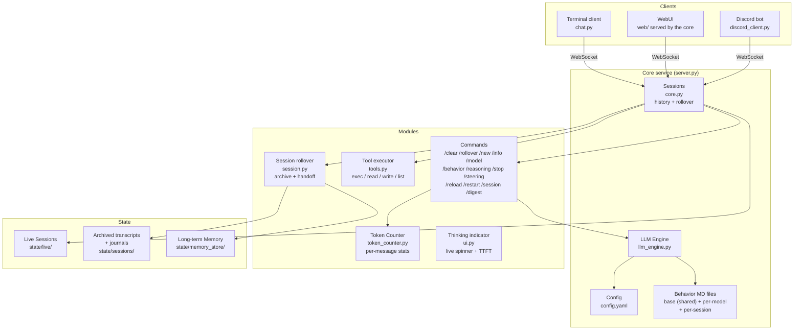

# Architecture

How the code is laid out, what each module owns, and what actually happens
during one turn. Written for someone who has to change this code.

The [README](../README.md) covers what letsClaw does from the outside.
[design-principles.md](design-principles.md) covers why it is shaped this way.
This file is the map between them.

---

## The shape in one picture



**Data flow:**

- **Core (`server.py` + `core.py`):** holds named sessions — history, model,
  rollover state, tools. Runs turns and emits events. Knows nothing about
  terminals.
- **Clients:** attach to a session by name over `ws://host:port/ws?session=<name>`.
  Several may attach to the same session and all see the same stream.
- **`chat.py`** is the reference client: it renders events and sends `submit` /
  `command` / `rollover_reply` / `stop`.
- **`web/`** is the same client in a browser, speaking the same protocol.
- **`discord_client.py`** is the same client again, with Discord on the far side:
  one socket per active channel, and nothing the core does not already hold.
  The core never imports `discord.py` and does not know it exists.

One long-lived core process. Clients are separate processes holding no
conversation state — see
[principle 1](design-principles.md#1-the-core-owns-the-conversation-clients-are-windows-onto-it).
`./serve.sh` starts the core and the bot together.

### The command node is a listing, and it is policed

Two names in that node are not core commands: `/session` maps a *channel* to a
session and lives only in the bot, and `/reasoning` is a display toggle local to
whichever client drew it. (`/stop` and `/steering` are protocol messages of their
own rather than commands, and `/help` is each client's.) All of them are in the
diagram because a person types them, and all are excused by name in
`tests/test_command_surface.py` — which checks every other word against
`Session.command()`, this node and the [terminal command
table](../README.md#commands-you-can-type) among them. Miss a listing when adding
a command and that suite names it; see
[extending.md](extending.md#add-a-command).

## Files

| file | lines | owns |
|---|---|---|
| `source/core.py` | 4198 | **the engine.** `Session` (one conversation), `SessionManager` (all of them), config reload, rollover, the thinking pad, commands |
| `source/session.py` | 829 | **the disk layer.** Live store, archives, the journal, the handoff summariser, the id registry |
| `source/server.py` | 1223 | **the transport.** aiohttp routes, the WebSocket handler, the Host and Origin guards, auth, backpressure |
| `source/llm_engine.py` | 984 | **the model.** Two transports (`chat` and `raw`), streaming, tool-call parsing, resume |
| `source/config.py` | 602 | **config.yaml → engines.** Loading, the webui presentation keys, number coercion, `build_all_engines` (which doubles as the validator), and the reload diff. Touches no `Session`, which is why it is not in `core` |
| `source/behavior.py` | 339 | **the behavior layers.** `BehaviorStore`, the read-through cache behind a lock, and the two directives extracted out of `base.md` |
| `source/config_edit.py` | 289 | rewriting the `webui:` block of `config.yaml` **as text**, so the file's comments survive a save |
| `source/ssh_forward.py` | 571 | **model servers over ssh.** One supervised `ssh -N -L` child per model entry that names an `ssh_forward`, on a port the core picks itself |
| `source/tools.py` | 823 | `exec`, `read_file`, `write_file`, `list_dir`, `show_image`, the search and edit tools, … and their JSON schemas |
| `source/logging_setup.py` | 107 | one rotating log file **per writer** (`letclaw-core.log`, `letclaw-discord.log`), because two processes sharing one file cannot rotate it safely |
| `source/token_counter.py` | 220 | counts with tiktoken's `cl100k_base`, cached under `state/tiktoken/` so it is fetched once ever rather than once per reboot; degrades loudly to 4-chars-per-token if the vocab cannot be loaded at all |
| `source/paths.py` | 151 | `REPO_ROOT` and `resolve()` — [principle 15](design-principles.md#15-one-definition-of-where-the-repo-is) |
| `source/version.py` | 25 | `__version__` — the release number, and the only place it lives. Separate from `PROTOCOL_VERSION` in `core.py`: that says whether a client can talk to the core at all, this says which build is running. **Every commit bumps it**, because several agents commit to this tree and a number that moves on judgement of "worth a bump?" stops moving |
| `source/chunker.py` | 307 | fence-aware message splitting; separate so it tests without `discord.py` |
| `source/chat.py` | 749 | the terminal client |
| `source/ui.py` | 86 | the terminal client's spinner and TTFT line |
| `source/discord_client.py` | 2555 | the Discord client |
| `source/discord_probe.py` | 49 | **"should the bot be started?", answered once.** `serve.sh` and `install.sh` both run it and read the verdict off the exit code; they used to each carry their own copy of the question and the copies drifted |
| `web/` | 2983 (`app.js`) | the browser client (`index.html`, `app.js`, `style.css`) — vanilla JS, no build step |

These are `wc -l` as of this writing, not estimates. The column drifted past
"useful" once before by carrying a `~` in front of every figure, which let it
be wrong by a third without failing anything — so if you would rather not
maintain it, drop the column rather than soften the numbers again.

### Around the modules: the rest of the tree

```
letsClaw/
  serve.sh                 the core          — start this first; also starts the bot
  install.sh               install serve.sh as a systemd service (user or system)
  terminalUI.sh            the terminal client
  run_discord.sh           the Discord bot on its own (serve.sh usually starts it for you)
  config.yaml              your settings (gitignored — it holds API keys and the bot token)
  config.example.yaml      the documented template to copy from
  models/                  behavior Markdown: base.md + per-model
    sessions/                per-session layer; every file gitignored but its README
  web/                     browser client: index.html, app.js, style.css, vendor/
  tests/                   every suite and helper; run_all.py runs them
                             (gitignored — local to the machine it was written on,
                              so a clone has none)
  source/                  all Python (the table above)
  state/                   live conversations, archives, journals, pictures, memory
                             (gitignored)
  logs/                    (gitignored)
  voices/                  TTS models for the voice module — 61 MB of regenerable
                             binary, so gitignored (.gitignore names the reason);
                             nothing shipped reads it yet. See
                             docs/webcam-voice-plan.md
```

Two things worth knowing about this shape:

- **The scripts stay at the root and the code lives in `source/`.** `serve.sh`
  runs `source/server.py`, which puts `source/` on the import path, so the
  modules import each other by plain name (`import core`) with no package
  machinery.
- **Everything the code reads is at the root, not beside it** — config,
  `models/`, `web/`, `state/`, `logs/`. `paths.py` holds the single definition
  of where the root is (`REPO_ROOT`) and a `resolve()` for config paths, which
  are taken as-is when absolute and root-relative otherwise. Anything needing a
  repo path should use those rather than computing its own from `__file__`.

`state/` is the only directory the core writes to, and it is worth knowing which
part of it is which, because two subdirectories are easily confused:
`state/live/` is the conversation you are having (rewritten as you go, reloaded
at startup) while `state/sessions/` is the archive — a write-once record of a
window that filled up. A rollover writes to the second and starts the first over.

`session.py` is imported as `store` and **never imports
`core`** — the dependency runs one way. Neither do `config.py`, `behavior.py`
or `paths.py`, which is what lets a test import any of them on their own.

---

## `core.py`

### `Session` — one conversation

Holds `history`, `engine`, the three behavior layers, per-session policy, and
the set of attached `Subscriber`s.

**Policy is copied per session, never read live off the shared config dict**
(`Session.__init__()`). A session that disables its own rollover must not disable
everyone else's.

Two odometers survive `/clear` and restarts: `total_output` and
`rollover_count`.

`session_id` — 8 hex, minted once in `Session.__init__()`, immediately replaced by
`SessionManager.get` with a registry-checked one so a collision cannot happen
silently. See [principle 5](design-principles.md#5-identity-is-the-session-id-the-name-is-a-label).

### `Subscriber` — one attached client's outbound lane

A bounded `deque` (`maxlen=2000`) plus a wake event. `push()` drops `reasoning`
events for clients that asked not to get them — **but never `reasoning_stat`**,
because a token counter is all a non-reasoning client has to show for a
two-minute think.

**`emit()` is synchronous and non-blocking by contract.** The engine calls the
streaming callback from inside the SSE read loop; awaiting a socket there would
stall *every session's* model read. Adding an `await` to `emit`, `push`, or any
`on_text`/`on_reasoning` path is the single easiest way to wreck this system.

### `SessionManager` — all of them

Owns the sessions dict, the engine cache, the behavior-file cache, tools and
their schemas (built **once** per core, not per session), and the two directive
templates.

Notable methods: `get` (create on demand), `restore` (eager at startup),
`reload`, `rename`, `delete`, `session_behavior_path`, `close`.

### History hygiene

Three free functions worth knowing before you touch the turn loop:

- **`settled(history)`** — returns a copy with any unfinished
  trailing turn popped: trailing `tool_calls`, `role="tool"`, or `role="user"`,
  back-to-front so a whole interrupted turn unwinds as a unit. Both `persist()`
  and `repair_history()` use it, so memory and disk agree on what "finished"
  means.
- **`truncated_tool_calls(result)`** — calls whose `arguments`
  are non-empty but fail `json.loads`. **These are never run**; `rm -rf
  /tmp/scratch` truncated to `rm -rf /` is the accident this prevents. Empty
  arguments are legitimate.
- **`stored_tool_args(tc)`** — what one call's `arguments` looks like in
  history: always a JSON object. The server re-validates every assistant
  message on every later request, so a stored `""` or `123` is a 400 on the
  *next* turn and on every turn after it, until the window rolls over —
  `truncated_tool_calls` decides what may run, which is a different question
  from what may be stored.
- **`strip_tool_markup(text)`** — removes `<tool_call>…` from
  prose. Only ever relevant on the raw transport.

---

## The turn, end to end

`Session.run_turn()` → `Session._turn()`.

### `run_turn` — the wrapper

1. **Busy check.** `if self.lock.locked()` → emit `busy` and return. A second
   submit is **refused, never queued**: running it would execute against a
   context its sender never saw.
2. Take the lock, bump `turn_id`, reset `round_id` to 0, clear the replay
   buffer, emit `turn_start`.
3. `await asyncio.wait_for(self._turn(text), engine.turn_timeout)`.
4. Timeout / cancellation / exception → `repair_history()` and a notice.
   `CancelledError` is **re-raised**, after the `finally`.
5. `finally`, in this order: `persist()`, then `emit(turn_end)` in that try's
   own `finally` — so `turn_end` means *on disk*, and a failing save cannot
   swallow the event. Then apply `_pending_config` if a reload landed mid-turn.

### `_turn` — the work

```
_headroom_check()           ← BEFORE the user message lands, so a roll starts
                              the fresh window with this turn's question in it
history.append(user)
jot("turn N user", text)

# room, not a round count — nothing mid-turn can roll over, so what the loop
# runs out of is window
while True:
    if _pad_headroom() < _min_tool_round_room():     # 4,400 at the shipped
                                                     # max_output_chars: 8000
        notice                                   # "no room left for another tool round"
        result = await call_round()              # no schemas: it must answer in words
        if was_cut_off(result):                  # thought hit the cap, said nothing
            result = await _think_pad(..., allow_tools=False)
        answer = result.text; break
    drain_steering()                             # a /steering queued during the last tool
    try:
        result = await call_round(tools=schemas)
    except RoundInterrupted:                     # /steering landed mid-round
        record_partial(); drain_steering(); continue
    if not result.wants_tool:
        if was_cut_off(result):
            result = await _think_pad(...)       # ← the notepad, below
            if result.wants_tool:
                await run_tools(result); continue
        if self._steering:                       # answer finished as a correction landed
            history.append(assistant of text); drain_steering(); continue
        answer = result.text; break
    await run_tools(result)

history.append(assistant)
emit(stats)
_digest_turn(user_msg, reasoning, blocks_before)   ← collapses this turn's
                                               working set, BEFORE rollover
                                               emit(digest_done) — note this
                                               precedes turn_end
_after_turn()                                ← rollover evaluated ONLY here,
                                               reading used_now()
```

**That order is load-bearing too.** Digesting after `_after_turn` would let
rollover throw the un-collapsed window away first, and the digest would be
doing nothing.

Rollover is evaluated only after the tool loop has fully drained, so no
`tool_call`/`tool_result` pair can be split across a window boundary.

### The four closures inside `_turn`

- **`call_round(...)`** — the single funnel for every model
  call. Measures TTFT, dispatches to `chat_with_tools` or `resume_round`, then
  `tally`, then journals **every path by construction**. This is the only place
  a pad's reasoning is ever recorded, since the pad never enters history.
- **`tally(result, history_shaped=True)`** — folds one round's
  usage in. **`history_shaped=False` for resumed rounds**: a resume's prompt
  carries the thinking pad, which never reaches history, so letting it set
  `last_prompt` would measure the window tens of thousands of tokens fuller and
  trip a spurious rollover. When `history_shaped=True` it does the converse and
  **publishes `_last_used` immediately**, not just at turn end: the prompt just
  sent *was* the current history, so it is a live measurement, and the pad wall
  reads it on every round. That is what lets a tool result landing mid-turn move
  the wall. See trap 7 for the obligation this creates.
- **`run_tools(result)`** — appends the assistant message
  (substituting `"{}"` for truncated calls so history stays server-valid),
  **reserves every result slot up front** with `"error: cancelled"` so a turn
  torn off mid-loop still leaves a well-formed history, then per call: emit
  `tool_call` *before* running, jot, run, **full output to the journal and
  clipped output to the model**, emit `tool_result`. A run of consecutive
  read-only calls (`PARALLEL_SAFE` in tools.py — `read_file`, `list_dir` and
  the three search tools) runs together through `asyncio.gather`, so three
  two-second reads take the two of the slowest; a write and an exec run alone,
  in their issued position, so a read after the write of the same path keeps
  the order the model meant.
  Results and `tool_result` events land in completion order; the slots, and
  the history, stay in issue order.
- **`push_reasoning_stat(...)`** — counts only the new slice,
  **cutting at the last space**, because a token carries its leading space
  (`" alpha"` is one token; `"alpha"` + `" "` is two) and cutting anywhere else
  inflates the running sum.

### Token accounting

`out_exact = rounds > 0 and out_reported == rounds` (in `tally()`) — the
server's sum is trusted **only if every round reported one**. A partial sum
looks authoritative while understating.

`used = last_prompt + count_text(answer) + 4`, deliberately **not** prompt +
completion: completion includes reasoning that is thrown away, which would
inflate the figure and can even make it *fall* as the conversation grows.

`reason_tok` is monotonic by construction (`max(...)`), and the final
`stats.reasoning_tokens` quotes the same variable the live counter used — two
numbers for one quantity reads as a bug.

---

## The thinking pad

`_headroom_check()` through `_think_pad()` and `_compact_pad()`. The most
intricate subsystem; read the section in
[principle 6](design-principles.md#6-separate-the-notepad-from-the-answer-sheet)
first.

**Premise:** reasoning and answer come out of one budget, so a round can think
hard and say nothing. Rather than bin that work, the reasoning becomes a *pad*
handed back unclosed, and the model continues mid-sentence.

> **The pad lives only in `_think_pad`'s local variable. It never enters
> `history`**, so it costs nothing after the turn and cannot
> move the rollover point. Keep it that way.

| function | |
|---|---|
| `_answer_reserve()` | `clamp(10% of free, 4096, max_output_tokens)`, then clamped to `free - 2000`, floored at 256 |
| `_pad_headroom()` | `budget - used_now() - _answer_reserve() - PAD_CONTEXT_MARGIN (2000)`. `used_now()`, not `estimate()` — it prefers the server's measurement |
| `_headroom_check()` | pre-turn rollover when headroom < `MIN_THINK_HEADROOM` (4000). Reads the *same* `_pad_headroom()` as the wall, and must keep doing so |
| `_think_pad(...)` | the resume loop |
| `_pad_tail(pad)` | the last ~2000 tokens **verbatim** — never summarised, because the model must resume *mid-sentence* |
| `_compact_pad(...)` | replaces the pad with `<checkpoint note> + tail`. Off by default; compaction is lossy |
| `_forced_conclusion(...)` | the fallback when `resume_mode` resolves to `off` |

**The resume loop is deliberately unbounded** (`_think_pad()`) — no round
budget, because a count is not a limit the machine actually has. It exits on:
the time deadline, the context wall, a finished answer, a non-`length` stop, or
**the no-progress guard** — cut off at the cap having written *nothing* means
the pad cannot grow, the wall will never move, and every further round is
identical. That guard is the sole replacement for the round counter.

**Tools during the pad:** `tools_ok = allow_tools and transport == "chat"`,
because only the chat transport parses tool calls. A resume that produces an
untruncated tool call returns immediately and the main loop runs it. In the
**answer phase** tools are offered once and only once — a resume must not call
one, because there is no way to splice a tool result into an unclosed thinking
block without forfeiting the pad.

`_forced_conclusion` has one wart worth knowing: **on success it leaves the
directive in `history`**, so a synthetic user message
permanently joins the conversation. Only on the non-resumable path.

---

## The four-layer system prompt

`Session.fresh_history()`:

```python
content = self.base_behavior                                    # models/base.md
if self.behavior:         content += "\n=== BEHAVIOR ===\n" + self.behavior
if self.session_behavior: content += SESSION_MARKER + self.session_behavior
if carryover:             content += CARRYOVER_MARKER + carryover
```

**The ordering is load-bearing.** `carryover()` recovers layer 4
by partitioning on `CARRYOVER_MARKER` and taking everything *after* it. Anything
appended below would be read back as part of the handoff and re-appended on the
next rebuild — growing the prompt every turn.

Corollary: a session-behavior file containing the literal string
`=== CONTINUED SESSION ===` will silently corrupt this.

**Three places rebuild `history[0]`, and each must round-trip `carryover()`:**
`reload_session_behavior()`, `roll_over()`, `use_model()`.
`restore()` avoids the problem differently — by assigning history *after*
`use_model`, which would otherwise destroy the carryover.

`apply_config` used to be a fourth and no longer is: it leaves `history`
alone on purpose, because the prefix it would rebuild is the one the server
has already tokenised, and rebuilding it mid-conversation costs every live
session its KV cache for a behavior edit it did not ask for. An edited file
is picked up instead by `refresh_behavior()` at the next rollover, `/clear`
or `/new` — the paths that were going to replace the prefix anyway.

Directives are computed from the **unstripped** base, which is why stripping
the `# Directives` group out of every prompt does not remove the core's ability
to send them at the right moment.

The rules this layer follows, each with its reasoning, are
[principle 2](design-principles.md#2-behavior-is-markdown-and-some-of-that-markdown-is-machinery)
(behavior is Markdown, and the two directive sections are machinery),
[principle 4](design-principles.md#4-key-on-the-session-name-not-on-the-clients-identity)
(key on the session name, not the client's identity) and
[principle 5](design-principles.md#5-identity-is-the-session-id-the-name-is-a-label)
(id is the identity, the name is a label).

### When the layers are read, and what re-reading one costs

The prompt is not frozen at startup, but it is only ever replaced at a point
where that costs nothing. The three layers live in `history[0]`, which is the
prefix the server has already tokenised, so rewriting it mid-conversation throws
away that session's KV cache. Two rules fall out of that, and they are what
`reload_session_behavior()` and `refresh_behavior()` exist to serve:

- **`/reload` moves settings, never the window.** It re-reads `config.yaml`,
  rebuilds the engines and tools, and reconciles the behavior files with disk —
  then leaves every live conversation exactly as it was, reporting which files
  changed and that they are pending.
- **`/rollover`, `/clear` and `/new` move the prompt.** Each rebuilds `history[0]`
  anyway, so each re-reads all three layers on the way through and says in the
  transcript which ones moved. A file created for an already-live session is
  picked up the same way.

So an edited `base.md` or `models/sessions/<name>.md` lands at the session's next
window rebuild; `/reload` tells you it is waiting, `/clear` applies it immediately.
A file that reads back *empty* is treated as a save in progress and ignored —
that is the state an editor passes through mid-write, and taking it would put a
blank prompt in front of the model for one turn.

The rollover summariser never sees the three layers: they are re-read verbatim
into the fresh window, so summarising them would put the same instructions in the
prompt twice, the second copy degrading at every later rollover. The carryover
itself *is* passed to the summariser, or the chain would forget everything before
the window that just ended.

The third layer is keyed on the **session name**, which is what makes a
per-Discord-channel file work without the core knowing Discord exists — the bot
names each session after its channel (`auto_names` → `dudus-den-solaris`), so
`models/sessions/dudus-den-solaris.md` is that channel's file. The same mechanism
covers `terminal.md` and any WebUI session, which a channel-id-keyed design would
have excluded. A directory rather than a config map, because sessions spring into
existence on attach: dropping the file in is the whole operation.

The name becomes a filename by the same rule `state/` uses — everything outside
`[A-Za-z0-9-_.]` becomes `_` — and the result must sit directly in `session_dir`
or it is refused. Both guards matter: `?session=` is not validated on attach (trap
11), so a session named `../../etc/passwd` can exist, and this is the one place a
session name becomes a path that is *read*. `session_behavior_path()` is where
that rule lives; replicate it if you add another.

### What `base.md` commits the model to

`models/base.md` is not just an identity blurb — several of its rules are
load-bearing, and two directives in it are lifted out and used as machinery.

| section | what it does |
|---|---|
| **How you work** | check with a tool rather than answer from memory; **decide rather than ask**; finish the whole task before answering |
| **Tools** | `read_file` has no offset, so large files go through `inspect_file` (structure map + line ranges); independent read-only calls may be batched in one message, because the core runs them together |
| **The record on disk** | search the previous window's [journal](#the-journal), and the `grep` line a turn digest ends with, before re-investigating anything |
| **Directives → `## Checkpoint`** | the text sent when a full notepad is about to be compacted — extracted by `extract_checkpoint_directive` |
| **Directives → `## Forced conclusion`** | the text sent when a server cannot resume a cut-off thought — extracted by `extract_conclude_directive` |

The last section, `# Directives`, is machinery rather than behavior. `behavior.py`
matches each `## ` heading under it **literally** — the level and the spelling are
both load-bearing — lifts out the paragraph beneath (HTML comments dropped: notes
to whoever edits the file, not words for the model), and sends it as a **`user`
message at the one moment it applies**. They live in Markdown rather than in
source so the wording is yours to tune with `/reload`, no code change and no
restart. Delete a heading and the core falls back, silently, to a short built-in
sentence in `behavior.py`. A bare `## Checkpoint` with no `# Directives` group
around it — the layout the file used before the group existed — is still stripped,
but only as far as the next heading of either level.

**The group never reaches the system prompt.** `strip_directive_sections()` cuts
everything from `# Directives` to the next `# ` heading out of the base layer
before the prompt is assembled — every model, every turn. A standing copy of a
directive is worse than redundant: a model that reads its whole prompt as
instruction will simply obey it. Claude Opus 5 over Argo, told on every turn that
"this is not the final answer", answers nothing at all. Stripping used to be
opt-in per model (`strip_directives: true`); that key is gone, because no model
benefited from the copy and the ones that merely ignored it were still paying for
it in tokens. An old `config.yaml` carrying the key still loads — unknown model
keys are ignored.

Stripping and extraction read the file **independently**, which is what lets both
halves work at once: `extract_*_directive()` sees the base as written, so the
directives still arrive at the moment they are meant to.

**The decide-rather-than-ask rule is the one to know about**, because of how the
loop is built: the agent loop runs while the model calls tools, and the moment it
emits text instead the turn is over. The core cannot tell a finished answer from
*"shall I do A or B?"*, and nothing in the reasoning machinery catches that case.
So a question is terminal whether or not it was meant to be, and this file is the
only lever on it. That is why the model is told to investigate both branches with
tools, pick one, and say in its answer which it picked and why it rejected the
other — asking only when proceeding would destroy data or cost money, or when the
missing fact exists nowhere a tool can reach.

---

## Rollover

`_after_turn()` → `_maybe_roll()` → `roll_over()`.

`trip = budget * rollover_pct / 100`; `0` disables. Modes: `auto` rolls, `ask`
prompts (and will not re-ask until usage climbs another 5% of budget), `off`
warns once.

**The loop-breaker** (in `_after_turn()`): after a successful roll, if the *fresh*
window still exceeds the trip, `rollover_pct` is set to `0` with a warning.
That setting is runtime-mutable and persisted, which is why `apply_config` uses
a divergence test rather than blindly reapplying config values, and why
`_headroom_check` refuses to act when `rollover_pct` is zero.

`roll_over` is **ordered for failure-safety**:

1. `save_transcript` **first** — a failed summariser or a full disk costs the
   summary, never the conversation.
2. Close the journal, *before* building the carryover, because the carryover
   advertises its path.
3. `summary_max = min(1500, budget//20, budget - used - 200)`; below 256 the
   summary is skipped with a warning rather than attempted badly.
4. `build_handoff` — exceptions warn and continue with the last exchange only.
5. `append_handoff` into long-term memory.
6. New `history[0]` from `format_carryover(...)`, plus `last_exchange` **only
   if it fits under the trip**.

`roll_over` does not call `persist()`; its caller does.

**Three caps bound the handoff, smallest wins** — the prose form of the
`summary_max` above:

| cap | value | why |
|---|---|---|
| `HANDOFF_MAX_TOKENS` | 1500 | four sections do not fit in less |
| a share of the window | `context_length / 20` | on a small model a fixed 1500 is a permanent tax on the context the handoff exists to save |
| what is free right now | `context_length − used − 200` | below `HANDOFF_MIN_TOKENS` (256) the summary is skipped and the last exchange is carried alone |

At 100k and above the absolute cap binds and you get the full 1500; only a
small-window model is scaled back. For the same reason the summariser is shown
each tool call's **arguments**, clipped to 200 characters: names alone would say
that a search returned nothing without saying what was searched for — which is
exactly the sentence RULED OUT needs to be able to write.

There is a second, earlier trigger, and it is evaluated *before* the turn rather
than after it: `_headroom_check()`. A window that is nearly full still has room
for one more exchange but none to *think* in, so a thinking model would have its
reasoning squeezed out exactly where a hard question needs it. With
`rollover_before_think` the core rolls over before such a turn instead of after
one that was already degraded. Auto mode only — `ask` must not put a question
before the turn has even started, and `off` means off. The arithmetic of where
that line sits is [reasoning.md §3](reasoning.md#3-the-pad-wall).

---

## Digest

`digest_turns` collapses a *finished turn* rather than rolling the window over.
Rolling over is a last resort — it costs a round, and the fresh window knows only
what the handoff says. The cheaper move is not to fill the window in the first
place.

Measured across four real sessions, the tool calls, their arguments and their
results were **91–95%** of the context. The answers anyone actually reads were
2–8%, and the questions asked were under half a percent. So at the end of each
turn, `_digest_turn()` replaces the part in between with one short model-written
digest:

```
before:   system │ user │ ⟨call ▸ result ▸ call ▸ result ▸ …⟩ │ answer
after:    system │ user │ answer │ DID / FOUND / CHANGED / RULED OUT
```

The question and the answer stay word for word; the working-out becomes
~300–500 tokens. On a 21-turn session that is roughly 173k → 24k, which is the
difference between rolling over routinely and rarely.

**Nothing is lost, and that is checked rather than claimed** — trap 12 is the
mechanism. Every tool call, every full result and every round of reasoning is
already in the journal, written *as the turn runs*, so the collapse only removes
a second copy. The same is true if the summariser errors, returns nothing, or
there is no room for the call: the turn is kept in full and a warning says so.

Each digest ends with the line that reaches what it replaced —

```
[full record: grep -n '^## turn 7 ' state/sessions/a3f91c2e_letsClaw_….md]
```

— appended by `build_turn_digest`, never written by the model (trap 13), and
`models/base.md` tells the model to run it rather than re-derive. That same line
is what `/digest expand` parses to put the turn back: the question and answer
stay the copies already in the window, and the working-out comes back the way it
ran, one assistant message per round of tool calls with the results in the order
they were issued, and unclipped where the journal kept more than the window had
room for.

Expansion fails the way the collapse fails. No pointer, a segment with no record
of the turn, a call with no recorded result — the digest stays, the reply names
which turn was kept and why, and nothing else in the window moves. A partial
expansion would be a partial loss, and the journal is the only other copy.

**Three caps bound a digest**, smallest wins, mirroring the handoff's: 600 tokens
absolute, `context_length / 50`, and what is free in the call itself. That last
one is measured against **the turn being summarised**, not the session's current
usage — the handoff summarises the whole history, so there `context_length − used`
is the room in its own prompt, but this call sends only one turn. Budgeting it
against `used` made the digest decline on exactly the turns big enough to be worth
digesting.

It is not free on every turn. A digest costs its own round and ~200–500 tokens
that every later turn then carries, so a turn whose tool output was a handful of
lines comes out slightly *bigger* collapsed than left alone — measured on a
three-turn session with small tool results, 3,134 tokens against the control's
2,719. It pays when tool output dominates, which is the common case and the one
the 91–95% was measured on: the same three turns reading whole files instead came
out at 3,115 against the control's 35,441.

It ships **off**. It is the first feature that discards context by design, so it
is opt-in until a model has run clean with it.

**A model entry may override it**, and `digest_turns` is the only `conversation:`
setting one may. The reason is the cost above: that round is billed to whichever
model the session is on, so a model whose `context_length` is large enough that a
turn will never need collapsing can opt out on its own. Omitting the key in a
model entry means "follow the conversation setting"; `false` there means off. A
`/model` switch re-resolves it, so moving a live session onto that model stops the
digesting and moving it back resumes.

**You are shown the digest, not just told one happened.** Every client prints it
as the turn closes — folded shut under a one-line headline in the WebUI, indented
under the answer in the terminal, posted after the answer on Discord. It is the
same treatment the rollover handoff gets, for the same reason: this text is what
the model sees from here on in place of the turn, so a digest that quietly dropped
the finding the turn existed to produce should be visible while the turn is still
fresh in your mind, rather than inferred two turns later from an answer that has
forgotten it. A token count could not have told you that.

`emit(digest_done)` **precedes `turn_end`** (see the pseudocode in
[`_turn`](#_turn--the-work)), which is what lets a client attach the digest to the
answer it belongs to rather than to whatever turn comes next.

The typed command — what `off`/`collapse`/`expand` each persist to, and why the
WebUI's 📄 button is a wheel rather than a toggle — is in
[clients.md](clients.md#the-digest-command).

---

## Config reload

`SessionManager.reload()` is the most consequential function in
the file.

1. **Validate before committing.** `load_config` + `build_all_engines` in a
   `try`; on failure return `{"ok": False, "error": …}` and change **nothing**.
   Building the engines *is* the validation — same code path a real turn takes.
2. Diff; identical → early return.
3. **`self.config.clear(); self.config.update(fresh)`** — mutated **in place,
   never rebound.** The manager, the aiohttp app and every `Session` hold this
   same dict; in-place mutation is what makes `core.token`, the state
   directories and `GET /models` pick up new values with no plumbing.
   **Rebinding it silently desynchronises all of them.**
4. Swap engines, clear the behavior cache, recompute directives, rebuild tools.
5. Per session, **iterating a list copy** (a client attaching during the
   `await` would otherwise mutate the dict mid-iteration): build a blob, and
   either apply it or stash it in `_pending_config` if the session is busy.
6. **Close only orphaned old engines.** A session mid-stream must keep its
   engine — closing the client under it aborts the read.

`apply_config()` is deliberately **synchronous and
assignment-only**: all I/O happens in `reload` beforehand, because the deferred
path runs inside `run_turn`'s `finally` while a `CancelledError` is
propagating, and an `await` there can be interrupted again and leave the
session half-updated.

**Restart-only settings:** `core.bind`, `core.port`, and the three keys that
`logging_setup.configure()` reads once when it installs the handlers —
`logging.file`, `logging.max_bytes`, `logging.backups`. `logging.level` is
not among them: `_reload` sets it on the root logger. Nor is
`core.allowed_hosts`, which `_host_ok` reads off the live config dict on
every request, so the in-place mutation in step 3 is what delivers it.

### Which key is in which tier

The three tiers, in full. The same division is stated for an operator in the
README's [reloading config](../README.md#reloading-config); this is the list a
change has to be checked against, because a key can only move between tiers by
someone changing where it is read.

| tier | keys | why |
|---|---|---|
| **Live already — no reload needed** | `core.token`, `core.allowed_hosts`, the `state/` paths, the model list `GET /models` serves | read per request off the live config dict, so step 3's in-place mutation delivers them; the reload's job here is only to update the dict |
| **Reload picks it up** | **every setting in every model entry** — `context_length`, `base_url`, `provider_name`, the sampling parameters, and all of the reasoning settings (`reasoning`, `max_tokens`, `max_output_tokens`, `max_pad_compactions`, `turn_timeout`, `answer_time_reserve`, `resume_mode`, `reasoning_effort`); added and removed models; behavior files including `base.md`; the tool allowlist and `exec_timeout`; every `conversation.*` setting; `logging.level`; and, in the bot's own process, the Discord allowlist (`discord.users`, `mention_only`, `mention_list`) | the engines are rebuilt from scratch in step 4, and the behavior cache is cleared with them |
| **Restart-only** | the six named above, plus — on the bot's side — **everything in `discord:` except the allowlist trio**: `enabled` (`serve.sh` reads it before deciding to launch at all), the three that say *where* the bot logs in (`token`, `core`, `core_token`), and the four it reads once when it builds its `Settings` (`idle_detach_min`, `max_lines`, `show_tools`, `auto_names`) | the socket is already bound, and rebinding drops every client, which is the thing a reload exists to avoid; the logging keys are read once at handler installation. The `discord:` half needs the *bot* restarted, which `/restart` does not do — it is a sibling process |

**What a reload does not do is as deliberate as what it does.**

- **An idle session takes the change immediately; a busy one takes it when its
  turn ends**, and the reply says how many of each. The deferred blob lives in
  `_pending_config` and is applied in `run_turn`'s `finally` — which is why
  `apply_config()` above is assignment-only.
- **A setting a session changed for itself is left alone.** The test is whether
  the session's value still equals what the *old* config said; if not, the
  session changed it deliberately and keeps it. A session that auto-disabled its
  own rollover (see §3 of [reasoning.md](reasoning.md)) is not dragged back into
  the loop it just escaped.
- **The reply names what moved, key by key**
  (`models.qwen38-local.context_length: 100000 -> 128000`), so a reload reports
  what it did rather than only that it happened.
- **A model deleted from the config does not move the sessions using it.** They
  keep the engine they have, which still works, and are told `/model` can no
  longer return to it. Stated from the code side: **a session pinned to a model
  that vanished from the config keeps its engine** rather than being silently
  moved — but that engine is no longer in `_engines`, so `close()` will not close
  it at shutdown. Known leak.

### `/restart` — for the keys reload cannot reach

`/restart` restarts the core process itself, from any client, which is what the
restart-only tier needs and used to mean a shell on the core's host.

It is **the same process afterwards**: the core `execv`s over itself, so the PID
does not change, `serve.sh`'s `wait` keeps waiting and systemd never sees a
service that stopped. Conversations are persisted on the way down and restored on
the way up. Every client is disconnected for roughly a second; the WebUI and the
Discord bot reconnect on their own, and the terminal client does not — it prints
that the core is restarting and exits, so run it again.

**The Discord bot is not restarted.** It is a sibling process started by
`serve.sh`, not a child of the core, and it survives the whole thing. Editing
`discord_client.py` and typing `/restart` runs none of what you just wrote; that
needs `serve.sh` itself restarted.

Two refusals, both before anything is armed:

- **A turn is running**, anywhere, not just where you typed it. The reply names
  the sessions. `/restart force` goes ahead and those turns are lost. This is
  also why `restart` sits *above* the busy guard in
  `Session.command()` ([protocol.md](protocol.md)): below it, a `/restart` typed
  into a busy session could never report *which* sessions are busy, which is the
  entire content of its answer.
- **`config.yaml` would not load, or would stop the core booting** — a port that
  is not a number, or a non-loopback `bind` with no `core.token`. `config.boot_blockers()`
  is what answers that, the same function `server.main()` refuses on at startup,
  so the two cannot disagree. It matters more than it looks: `serve.sh` hands the
  core's exit status to a unit with `Restart=on-failure` and no
  `StartLimitBurst`, so a restart onto a broken config is not a failed restart
  but a core in a loop — and `/restart` is exactly what you reach for just after
  editing the config.

A `systemctl stop` or a Ctrl-C arriving in the fraction of a second between the
reply and the exit wins: the core stays stopped rather than coming back from a
stop nobody could then undo. `_RestartState` is what those two paths agree on.

---

## `session.py` — the disk layer

Two stores, deliberately separate:

| | path | |
|---|---|---|
| **live** | `state/live/` | rewritten every turn, read back at startup |
| **archive** | `state/sessions/` | write-once, never read back into a conversation |

### Live

`live_path` is `<safe-name>-<sha1(name)[:8]>.json`. **The digest is the key;
the readable half is cosmetic** — the slug is lossy (`my session`, `my/session`
and `my+session` all flatten identically) and truncates at 40 chars. The real
name lives inside the file.

`save_live` is **atomic by rename**: write `.tmp`, `flush`, `os.fsync`,
`os.replace`. Compact JSON, not indented — it runs after every turn.

`load_live` never raises. It skips unparseable files, malformed shapes, and
**wrong `LIVE_SCHEMA`** — each with a log line, and **never deletes them**.

> ⚠️ **Bumping `LIVE_SCHEMA` silently discards every user's live
> conversation.** This is why `session_id` was added additively.
> [Principle 12](design-principles.md#12-bookkeeping-must-never-cost-a-turn).

### The id registry

`logs/session_ID.log`, **rewritten in full on every change** rather than
appended, because an id must be able to *leave* when its session is deleted.
Tab-separated, not whitespace-split, because session names contain spaces.
`register_id` is an **upsert**, so a rename is reflected and `created` survives.

32 random bits collide about once in 4.3 billion, so the registry is what turns
"unlikely" into *cannot happen* — and that gap matters because a collision would
be silent: two conversations sharing an archive prefix, with nothing to complain
about it. A deleted session's id goes back to the pool, because the archives that
named it are purged in the same breath, so nothing on disk still carries it. The
one case that can leave files behind is a purge that failed, which is the
remaining argument against reissuing an id in that situation.

A live session file written before ids existed has none; it is assigned one at the
next restart, registered, and persisted from then on.

### Archives and the index

`save_transcript` → `<sid>_<safe-name>_<stamp>.json`. Encoding **and** writing
both go through `to_thread`, because a 262144-token history can be megabytes
and would otherwise stall every other session's stream. The write is
`paths.atomic_write`, like every other durable write here — not for the rename
(the name is fresh, there is nothing to replace) but for the fsync. `roll_over`
drops the live history once this returns, so a torn archive is not a damaged
copy of the conversation, it is the conversation.

`state/sessions/index.jsonl` holds four record types — `archive`, `journal`,
`rename`, `delete`. **The index exists because a filename is not an identity**:
transcripts written before a rename keep the old name forever, and the id is
what joins them. The index is append-only, so `delete` cannot retract the lines
its session wrote; the `delete` record is the tombstone that explains why those
files are no longer on disk.

`purge_archives` (called by `/new` and by deleting a session) **refuses an empty
or all-zero id**,
because `"0"*8` is the shared prefix used by id-less writers and matching on it
could take out someone else's archive. There is no undo.

### The journal

An append-only Markdown record of one session *segment*. It exists because the
JSON archive is structurally missing two irrecoverable things: **the model's
reasoning** and **untruncated tool output**.

Markdown and not JSON because `read_file` has no offset and truncates at 8000
chars — a 400 KB JSON archive is unreachable to the model, while a
one-header-per-line file is reachable at any size via `grep`/`sed`. The header
convention (`## turn 12 round 3 tool_call exec call_a1b2  [16:04:11]`) makes
`grep -n '^## turn'` a table of contents.

That `turn`/`round` pair is the same one the clients draw in their left gutter
(`#12.3`), because `emit()` stamps every event with it and every history record
carries it — so a block on screen is greppable in the journal by the number
printed beside it. Both keys are display-only and `api_messages()` strips them,
alongside `at`, before anything is sent to the model.

The same pair is what makes a digest reversible. `build_turn_digest` appends a
`[full record: grep -n '^## turn N ' <path>]` line to every digest — appended,
never written by the model — and `/digest expand` recovers the turn number and
segment path from it with `DIGEST_POINTER_RX`. Trap 13 is the corollary.

`write()` never raises, and **a single `OSError` closes the segment for good**
rather than warning once per block. Unlike `save_transcript`, `Journal._open`
**does disambiguate** with a `-2` suffix: a rollover closes one segment and
opens the next in the same second, and colliding there would append the new
window to the closed segment.

The segment is stamped at its **first write**, not at construction, so a session
nobody speaks in leaves nothing behind; a rollover closes it and the next turn
opens the next one. `conversation.journal: false` switches the record off (and
with it the digest, which is gated on it — trap 12), and
`journal_max_block_chars` (default 1,000,000) caps a single block, so one runaway
`cat` costs a megabyte rather than the volume.

### The handoff

`build_handoff` runs the summariser on **its own message list** — the real
history is never touched. Four mandated sections: OBJECTIVE / ESTABLISHED /
**RULED OUT** / OPEN. It sends `enable_thinking: False` as a template kwarg and
**retries without the hint** if the server rejects it.

`format_carryover` emits three literal `grep` commands for the journal and
explicitly tells the model **not** to `read_file` the record — pointing it at a
file it can only ever see 2% of is worse than saying nothing.

`last_exchange` skips anything with `tool_calls` and every `role="tool"`
message: half of a tool-call pair in a fresh history is a 400 from the server.

---

## `server.py` and the protocol

See [protocol.md](protocol.md) for the full reference. The three structural
points:

- **The writer task is the sole owner of the socket for outbound traffic**, so
  a stalled peer cannot stall generation. Overflow drops the client with close
  code 1013 and it reconnects with `last_seq`.
- **`submit` runs as `create_task` and is never awaited inline**, so the reader
  stays live for `stop` and `rollover_reply` during a long turn.
- **The browser defence is two headers, not one, and the Host half is a
  middleware.** `_same_origin` only establishes that the browser agrees with
  itself: Host is client-supplied, so a page on a domain re-pointed at
  127.0.0.1 sends a matching Origin and Host honestly and passes. `_host_guard`
  is what pins the other half, refusing any request whose Host is not a name
  this machine answers to — loopback, the bind, the hostname and FQDN and
  what they resolve to, computed once at `build_app` because `getaddrinfo`
  must not run per request, plus whatever `core.allowed_hosts` adds for a
  reverse proxy. It is a middleware rather than part of `_guard` because
  rebinding pays off on the *read* routes too: `/sessions`, `/config` and
  `/sessions/<name>/history` are whole conversations, and `/files` is the
  directory the agent's pictures land in. `/health` is the one
  exemption, since a container probe calls it under whatever name the
  orchestrator invented.

---

## Traps

Collected from reading the code. Each of these has a comment in the source
explaining it; this is the index.

1. **`emit()` must never await.** See above. Everything else on this list is
   recoverable; this one wrecks the system.
2. **The thinking pad must never enter `history`.**
3. **Layer 4 must stay last in the system prompt**, and every rebuild of
   `history[0]` must round-trip `carryover()`.
4. **`self.config` is mutated in place, never rebound.**
5. **`LIVE_SCHEMA` bumps discard users' live conversations.**
6. **`/new` is irreversible**; `/clear` is not. Do not make them more alike.
7. **`_last_used` is published mid-turn** by `tally` on every round where
   `history_shaped=True`, so the pad wall tracks the window as tool results
   land. The corollary: **every path that changes what the next prompt contains
   must clear it.** That is `repair_history`, `apply_config` (when the tool
   schemas moved — the history is untouched, but the other half of the prompt
   is not), `_digest_turn`, `_expand_digests`, the `max_history` trim in
   `_after_turn`, `roll_over`, `use_model`, and both `/clear` and `/new`. Nine
   sites; the only other two assignments are `__init__` and `load_state`, which
   set the value rather than invalidating it. The easy-to-miss ones are
   `apply_config` and `_expand_digests`: neither reshapes `history` the way a
   trim does, and both change what the next prompt holds. Leave it set and the
   next headroom check reads a window that no longer exists, then rolls over to
   relieve pressure that call had already relieved.
8. **`persist()` writes `settled(history)` but does not modify the live
   history** — disk and memory intentionally disagree after an interrupted turn
   until `repair_history()` runs. Don't "fix" it.
9. **`/reload` is intentionally outside the turn lock** (`Session.command()`).
   Taking it deadlocks, because `reload` defers busy sessions and would defer
   the one that asked.
10. **An unknown command issued during a turn reports "a turn is running"**,
    not "unknown command" — the lock check precedes the fall-through.
11. **Session names are unvalidated at creation**; only `rename` validates.
    `session_behavior_path` is the double guard. If you add another place where
    a session name becomes a read path, replicate it.
12. **A digest requires a demonstrably healthy journal.** `_digest_turn`
    discards the only in-context copy of a turn's working-out, so it checks
    rather than assumes: `journal_ok()` **and** `journal_blocks()` strictly
    greater than the high-water mark taken before the turn started. `jot()`
    never raises — a segment that filled the disk on the first tool call looks
    exactly like one that recorded everything, and dropping history on that
    evidence would be silent, total loss. Everything else in that method fails
    toward keeping the context.
13. **`/digest expand` parses the pointer, not the model.** The
    `[full record: grep …]` line is appended by `build_turn_digest`, never
    written by the model, precisely so the undo can recover the turn number and
    segment path with `DIGEST_POINTER_RX`. A model asked to point the way back
    into its own journal transcribes paths inaccurately, and a wrong path reads
    as "no record of it" rather than as an error.
14. **"Servable" must stay equal to "in `webui.files_dir`".** `exec` and
    `read_file` reach anything this process can, so `show_image` is the single
    place a file crosses to the side anyone holding `core.token` can fetch over
    HTTP — and it **copies** rather than serving the original path for exactly
    that reason. `/files/<name>` then refuses anything that is not a flat
    filename with an image extension: a remote URL, a `data:` URL, a
    subdirectory, a traversal and a symlink pointing out of the root are all
    turned down, by the renderer *and* again by the route, because this is the
    one path that turns model output into a filesystem read. Widen either side
    and the invariant is the thing that breaks, not the feature. It never
    overwrites either: a name already held by *different* bytes gets `-2`,
    because the directory is shared by every session and a silent clobber would
    cross conversations. (Re-copying identical bytes reuses what is there.)
15. **Lift maths before markdown, never after.** `$…$`, `\(…\)`, `$$…$$` and
    `\[…\]` are extracted from the text *before* the markdown pass, because
    otherwise `*` and `_` in an exponent become emphasis. And `$` inside a code
    span or a fenced block is never maths — `echo $HOME` and `it cost $5` stay
    literal. A formula KaTeX rejects keeps its source in the theme's error
    colour rather than taking the message down, and if KaTeX fails to load the
    page falls back to the TeX source in a code span: the vendored copy in
    `web/vendor/` is a checked-in file, not a CDN link, because the core often
    has no route to the internet.
