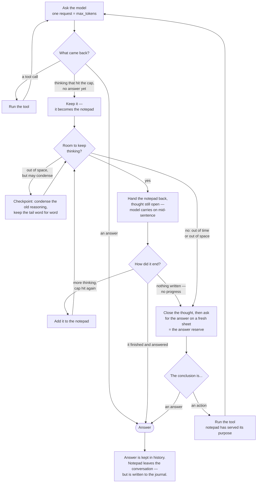

# Reasoning: tokens, walls, and where the thinking goes

The README's [Reasoning: the Notepad and the Answer
Sheet](../README.md#reasoning-the-notepad-and-the-answer-sheet) explains the
notepad as a user-facing idea and stops there. This document is the mechanical
half: which number caps which request, the arithmetic behind the two budgets,
every way thinking can stop, where the reasoning ends up, and which invariants a
change here must not break. Where a key's *behaviour* is at issue it is here;
where its *default* is wanted, that is `config.example.yaml`.

Read it if you are tuning a model so a long thought survives, or if you are
about to touch `_answer_reserve`, `_pad_headroom`, `_headroom_check` or
`_think_pad`.

---

## 1. Two budgets, not one

There are exactly two token numbers in play, and conflating them is the
mistake this document exists to prevent.

| | `max_tokens` | the answer reserve |
|---|---|---|
| set by | config, per model | computed, per round |
| caps | **one round's total output** — on a thinking model that is reasoning *and* answer together | **the closing round**, which runs past `</think>` so every token buys answer |
| config knob | `max_tokens` | `max_output_tokens` is its **ceiling**, not its value |
| typical | 4,096–8,192 | 4,096 up to `max_output_tokens` |

`max_tokens` is a chunk size. A round cut off mid-reasoning is *resumed*, not
re-asked, so this number does not limit how much the model may think in total
— it only decides how many instalments the thinking arrives in. Smaller is not
cheaper: the pad is re-sent as a prefill every round, so halving it roughly
quadruples the prompt tokens processed for the same thinking.

**Nothing caps total reasoning in a turn.** The pad loop is unbounded in rounds
on purpose (`_think_pad()`): *"There is no round budget, because a count is not
a limit the machine actually has."* What stops it is time, context, or the
model running dry — all three of them real.

### Which round runs under which cap

| round | what it is | cap |
|---|---|---|
| first round | the opening request of a turn | `max_tokens` |
| tool round | came back asking to run a tool | `max_tokens` |
| resume round | continues a cut-off thought, pad handed back unclosed | `max_tokens` (`lap_cap`, in `_think_pad()`) |
| checkpoint round | condenses a full pad so thinking can continue | **the answer reserve** |
| closing round | thinking is shut with `</think>`, the model writes the reply | **the answer reserve** |
| forced conclusion | the server cannot resume; the directive goes in and the round re-runs | `max(answer reserve, max_tokens)` (`_forced_conclusion()`) |

### Can a tool run while the pad is open?

Not mid-thought; yes at the end.

**Mid-thought there is nowhere to put the result.** A conversation has no way to
say *"here is what `exec` returned — now carry on inside the sentence you were
halfway through"*. Calling a tool mid-thought would mean abandoning the pad,
which is the one thing this mechanism exists to protect. That is why the resume
rounds in the table above carry no tool schemas, and why `tokens.md` records a
resume prompt as carrying none.

**At the end, yes.** By then the pad has done its job: it worked out *what to
do*. If the conclusion is an action rather than a sentence, the tool runs and the
turn carries on with the result in hand — thinking afresh from there if it needs
to. The closing round is offered the tool schemas whenever it can use them, and
`_think_pad()` returns the round that wants a tool rather than swallowing it.
Room is still checked: the loop that reaches this point is the same one governed
by `_min_tool_round_room()` above, and a turn with no room left for a tool result
asks for words instead.

The two safety rails on that path — a truncated tool call is never run, and the
raw transport offers no tools at all — are under the transports below, and
[principle 9](design-principles.md#9-fail-toward-the-safe-side).

## 2. The answer reserve, exactly

`Session._answer_reserve()`. Four clamps, in this order:

```
free     = budget - used_now()
want     = max(ANSWER_RESERVE_SHARE * free, MIN_ANSWER_ROOM)   # 10%, floor 4096
want     = min(want, max_output_tokens or max_tokens)          # ceiling
return     max(ABSOLUTE_ANSWER_FLOOR, min(want, free - PAD_CONTEXT_MARGIN))
```

with `ANSWER_RESERVE_SHARE = 0.10`, `MIN_ANSWER_ROOM = 4096`,
`PAD_CONTEXT_MARGIN = 2000`, `ABSOLUTE_ANSWER_FLOOR = 256` (module constants at the top of `core.py`).

Three consequences that are not obvious:

- **The ceiling wins against the floor.** A server capped below 4,096 cannot be
  talked into writing more by reserving more.
- **The room wins against both.** On a window smaller than the floor — a 12k
  context two-thirds full — reserving 4,096 reserves space that is not there,
  and the closing round would ask for a prompt plus an answer that together
  overflow. Clamped here, the pre-turn gate closes instead.
- **`ABSOLUTE_ANSWER_FLOOR` is never 0**, because some servers read 0 as "no
  limit" — the one reading under which an overflow is guaranteed.

### `max_output_tokens` only binds sometimes

It is a ceiling on a share, so it binds **only where 10% of the free window is
above it** — which means it is a question about the *window*, not about how
full it is:

```
the ceiling can bind  ⟺  10 × max_output_tokens  <  context_length
```

On the shipped `qwen38-local` pair — a 100,000 window and a 32,768 ceiling —
that inequality is false, so **the ceiling never binds at any point in the
window.** Even on an empty session 10% of free is 10,000, well under 32,768;
the share is the smaller number from the first turn to the last and the knob is
slack throughout. Raising it buys nothing. Lowering it *does* — below roughly
10% of your window it becomes what the answer sheet is sized to, and starts
taking room away from thinking.

A ceiling that can bind needs a window more than ten times its size: 32,768
wants over 327,680 tokens of context, and 8,192 wants over 81,920. On a 1M
window a 32,768 ceiling binds until the session is two-thirds full, and after
that goes slack again — the only case where "it binds sometimes" is literally
true.

This is why three notices in the code that say *"raising `max_output_tokens`
may help"* are usually wrong: they fire precisely when the reserve was pinned
by the share, the floor or the room clamp, none of which the ceiling can lift.
The advice that applies is **roll over**, or lower `rollover_at_percent`.

### Why the reserve is a share and not the ceiling

Sizing the sheet from the room that is left, rather than fixing it at
`max_output_tokens`, is what makes the reserve affordable at all. A fixed 32,768
on a 100k window is a third of the context held back on *every* turn, including
the empty ones — which put the pre-turn rollover at **61%** of the window while
the UI drew its first warning at 80% and the rollover tick sat at 90%. The
rollover that actually fired did so **29 points before anything on screen said
it would**. The share is what closed that gap; §3's gate table is the same story
at the other end of the window.

Worked through on a 100k window with a short conversation:

| | |
|---|---|
| `context_length: 100000` | the whole window |
| − conversation (say ~2,000) | question, history, tool results |
| − answer room (9,800) | 10% of the 98,000 free; under the 32,768 ceiling, so the ceiling is inert |
| − `PAD_CONTEXT_MARGIN` (2,000) | slack, since the token count runs low |
| **= pad headroom** | **~86,000 tokens** |

Late in the same window the shares invert, and this is the part the clamp order
in the listing above is for: at 95% full, 10% of what is free is 500 tokens, so
`MIN_ANSWER_ROOM` (4,096) takes over, and what survives the margin clamp is the
answer sheet's real limit. By then the pre-turn gate is closing and the session
rolls over.

At `max_tokens: 8192` that ~86,000 is roughly **eight** resume rounds — but
eight is an outcome, not a setting. Shrink the conversation and it rises; fill
history with tool results and it falls. Nothing in the config expresses it.

**Thinking room is a ceiling, not a reservation.** Nothing is pre-allocated: a
simple question answers on the first round and costs one request, and the pad
grows into whatever the window has spare only when the model actually uses it.

## 3. The pad wall

```
_pad_headroom() = budget - used_now() - _answer_reserve() - PAD_CONTEXT_MARGIN
```

Thinking continues while `_pad_headroom() - count_text(pad) > 0`.

Two things about `used_now()` matter here:

- It prefers the **server-measured** prompt size (`_last_used`) and only falls
  back to the local estimate. Which one is in force is reported at startup, so
  an estimate is never mistaken for a measurement. The estimate is calibrated
  rather than padded — a flat `×1.6` here used to make a half-full window read
  as full, which rolled sessions over to relieve pressure that was not there.
- `tally` publishes `_last_used` **mid-turn**, on every round whose prompt was
  exactly the current history (`history_shaped=True`, in `tally()`). A tool
  result landing between two pad rounds therefore moves the wall immediately.
  The corollary is an invariant — see §7.

**The pre-turn gate is not independent policy.** `_headroom_check()` rolls
the session over before a turn when
`_pad_headroom() < MIN_THINK_HEADROOM` (4,000). It reads the same
`_pad_headroom()` the wall does, and must keep doing so: when the two were
allowed to differ there was a band where the gate waved a turn through, the
wall then allowed zero thinking rounds, and the closing round asked for more
than the window held — a 400 that discarded the turn.

The gate's threshold is **absolute**, roughly
`MIN_ANSWER_ROOM + MIN_THINK_HEADROOM + PAD_CONTEXT_MARGIN ≈ 10,100` tokens of
free window. As a percentage it therefore depends entirely on window size:

| `context_length` | gate trips at about |
|---|---|
| 1,000,000 | 99% |
| 262,144 | 96% |
| 100,000 | 90% |
| 32,768 | 69% |
| 12,000 | 16% |

On a 100k window it lands on `rollover_at_percent: 90` and the headroom wall
and the rollover tick stop being two different walls. On a small window it is
still a much earlier second wall, and that is the configuration to watch.

The gate is also **skipped entirely** unless `rollover_mode == "auto"` **and**
`rollover_before_think` **and** `rollover_pct != 0`. A session can reach the
last of those on its own: `_after_turn` auto-disables rollover when even a
fresh window already trips the threshold. In that state a turn may start with
no thinking room, the pad loop allows ~zero rounds, and nothing says so.

### Pushing the wall back: compaction

Of §4's three real constraints, only this one can be moved, and
`max_pad_compactions` moves it.

When the pad fills the window, instead of concluding there the core asks the
model to write a **checkpoint**: a note of every figure it worked out, every
assumption it made, and what is still to do. That note, plus the last
`PAD_TAIL_TOKENS` (~2,000) kept **verbatim**, becomes the new pad — and the loop
carries on with room to spare. It is `roll_over()` one level down: keep the
meaning, drop the bulk.

Keeping that tail verbatim is the whole trick rather than a detail, and it is
invariant 5 in §7. A summary of where the model *was* cannot be carried on
mid-sentence, so the older reasoning is condensed while the sentence it is
actually inside is left untouched.

Turn this on and thinking is bounded by **time alone** — which is what the space
wall was really standing in for. Any **negative** value means no compaction
budget at all; `0` already meant *never*, so until the negative spelling existed
there was no way to say *always*. It is still bounded, just not by a count: the
turn clock stops it, and a cycle that fails to make the pad smaller stops it
(exit 5 and exit 8 in §4).

**It ships at `0`, deliberately.** Condensing loses detail, and for a calculation
that carries exact numbers through many steps, concluding from a complete pad
usually beats continuing from a summarised one — a lost intermediate value
produces a wrong answer that looks perfectly reasonable. Raise it for work long
enough that running out of room is the worse of the two failures. Exit 5's note
above covers what happens when the model cannot write the checkpoint: the tail is
kept mechanically and thinking goes on, which is lossier but keeps the resume
point intact.

## 4. Every way thinking stops

Eight exits. The first is the only one that loses work.

| # | exit | notice | work lost |
|---|---|---|---|
| 1 | **`resume_transport()` is `off`** — the server cannot prefill, so `_think_pad()` goes straight to `_forced_conclusion()` | `reasoning was cut off and this server cannot resume it` | **the whole seed round's reasoning** |
| 2 | time — `turn_timeout - answer_time_reserve` reached | `thinking stopped at the N s answer reserve` | none; concludes from the full pad |
| 3 | context, compaction exhausted — `compactions >= max_pad_compactions`, which a **negative** setting switches off entirely | `thinking filled the context` | none |
| 4 | context, pad too small to compact — `count_text(pad) <= PAD_TAIL_TOKENS * 2` (4,000); everything would survive as the verbatim tail anyway | `…too little to compact` | none |
| 5 | a checkpoint failed **and** the pad's tail was no shorter than the pad — `_compact_pad()` returned `""` and `_pad_tail()` could not shrink it | — | none: *"concluding from a complete pad is the fallback, losing it is never"* |
| 6 | the model answered — it closed the block itself and the text was complete | — | none |
| 7 | the model stopped without text and without being cut off | — | none |
| 8 | no progress — cut off at the cap having written nothing, so the pad cannot grow and every further round would be identical | `reasoning stopped making progress` | none |

**A turn never ends silent.** If it produces no answer — rare now that reasoning
is resumed rather than discarded, but possible if even the closing round comes
back empty — the turn says what it spent anyway. A failed turn should not also be
an invisible one; the stats line is the only evidence such a turn ever happened.

Separately, the round loop in `_turn()` ends the turn's *work* independently
of any of this, on the same rule the pad uses and for the same reason: when
`_pad_headroom()` drops below `_min_tool_round_room()`, it stops asking for work
and asks for words: `no room left for another tool round — asking for a final
answer`. That figure is **4,400 at the shipped `tools.max_output_chars: 8000`**
— one clipped tool result plus the message and arguments carrying it — and
`MIN_TOOL_ROUND_ROOM` (4,000) is only the floor under it: the method derives
the rest from a configurable clip length, so raise the clip and the room check
rises with it. It reads `_pad_headroom()` rather than a figure of its own, which is
invariant 1 in §7: a third name for one number is how the gate and the wall
drifted apart before.

Exit 5 deserves a note, because it used to be the worst of them. A checkpoint
that came back empty ended the turn's thinking outright — with
`max_pad_compactions: 10`, one bad note on the first cycle cost the other
nine. It now falls back to keeping the pad's tail (`_pad_tail()`,
`PAD_TAIL_TOKENS`) and thinking on. That is lossier than a real checkpoint —
the older reasoning is dropped mechanically instead of being distilled — but
the tail is the resume point, which is the part that has to survive verbatim
anyway. Only when even the tail cannot shrink the pad does the turn close,
and it closes by concluding from a complete pad rather than by losing it.

## 5. Where the reasoning goes

The whole loop, end to end — where the pad grows, where it is condensed, and
where it leaves the conversation:



**"Thrown away" means out of the conversation, not off the disk.** Every round
of the pad — each resume, each checkpoint — is appended to the session's journal
as it happens, so a notepad that cost twenty minutes of thinking is still
greppable afterwards even though the next prompt has no trace of it. Keeping the
pad on disk costs nothing; keeping it in history would re-send it every round and
drag the rollover point forward. The two questions are separate and the
distinction is what makes an unbounded pad affordable.

**Not into history.** The pad lives in `_think_pad` and nowhere else; it is
re-sent as a prefill each resume round and is gone at turn end. It costs
nothing afterwards and cannot move the rollover point. Rounds carrying it are
tallied with `history_shaped=False` so they do not corrupt the window
measurement either.

**Into the journal, every round.** `state/sessions/*.md`, written as the turn
runs, under greppable headers `## turn N {round|resume|closing} M`
(`call_round()`). This is the only durable copy — see design principle 7.

**Into the digest, in paraphrase, when `digest_turns: true`.** `_digest_turn`
passes the last `DIGEST_PAD_TAIL_CHARS` of the pad to
`build_turn_digest`, because a digest written without it *"can describe what
happened and not what it was for"*. The digest **is** appended to history. It
is counted like any other message, so principle 3 holds — but "reasoning is
never in history" is true of raw reasoning only.

### The two transports

Resuming a thought means asking the server to *continue* a half-written reply
rather than start a new one, and not every server exposes that. `resume_mode:
auto` probes once and picks:

| server | method | why not the obvious one |
|---|---|---|
| vLLM, SGLang | `continue_final_message` on the normal chat endpoint, with `add_generation_prompt=False` | — |
| llama.cpp | its raw `/completion` endpoint, prompt built by `/apply-template` | the chat endpoint ignores a half-written reply, so prefilling it silently re-asks the question |
| neither (or `resume_mode: off`) | no resume: `_forced_conclusion()` runs the `## Forced conclusion` directive from `base.md` | this **throws the thinking away** — it is exactly what the notepad was built to avoid, so it is a fallback and nothing more. It is exit 1 in §4, the only stop that loses work |

Two consequences of the raw transport are worth knowing before writing a fourth
client, because neither is visible in the protocol:

- **Tool calls are not offered on the raw resume path.** `/completion` returns
  plain text and cannot report a tool call properly, so the model is asked for
  words instead and any `<tool_call>` markup that arrives anyway is stripped
  rather than executed. On the chat endpoint the server parses calls correctly,
  which is why `ToolMarkupFilter` is confined to the raw transport — executing
  markup on the chat path would mean running a tool call the model was merely
  *writing about* ([principle 9](design-principles.md#9-fail-toward-the-safe-side)).
- **`/apply-template` is a llama.cpp endpoint**, so the raw path cannot work
  against any other server even where `/completion` exists.

### How reasoning is parsed off the wire

Two channels. Both transports read both, through one shared scanner:

| transport | dedicated channel | inline `<think>` |
|---|---|---|
| `chat_with_tools()` | `reasoning_content`, or `reasoning` — the spelling newer vLLM builds give the same field, read as a fallback by all three sites | `InlineThinkSplitter`, per delta and on the whole message |
| `_raw_complete()` | none — /completion has no such field | `InlineThinkSplitter`, seeded `start="reasoning"` |

`InlineThinkSplitter` is one class on purpose. There were two scanners for
this tag, they disagreed at the boundaries, and the disagreement was a real
bug: a close tag ending exactly on a chunk boundary leaked the tag's own
newlines into the answer. Its three entry states are the difference between
the transports — `deciding` (chat: a tag may or may not be first),
`reasoning` (raw, growing a pad: the prefill already opened the block) and
`passthrough` (raw, closing round: already past the close tag).

llama.cpp's `--reasoning-format` decides which channel the server uses:

| mode | thoughts arrive in | effect |
|---|---|---|
| `auto` / `deepseek` | `message.reasoning_content` | correct |
| `none` | `message.content` | caught by the splitter and kept out of history |
| `deepseek-legacy` | both | the copy in `content` is caught by the splitter and kept out of history; the two copies are then **concatenated**, so the trace is shown and journalled twice. Reported as `both` and warned about — fix the server rather than the doc |

**The splitter engages only on a stream that *opens* with the tag.** That is
what a template emits, and the restriction is what lets an answer that merely
writes about these tags — an ordinary thing to do in this repo — through
untouched.

The startup probe (`LLMEngine.capabilities()`) acts on what it finds rather
than only reporting it, and the useful verdict is the negative one. The
splitter defaults **on**, because its two failure modes are not comparable: a
trace let into history is permanent and invisible, while a tag stripped from
an answer is visible at once. A `separate` verdict is the only proof that the
server has a channel of its own, and it is what switches the splitter off.
`silent` and `unknown` are not proof and leave it armed.

Under `none` or `deepseek-legacy` the probe still warns, because a server
nobody fixed goes on making letsClaw recover its thinking from markup — which
works, but is a guess where there could be a field.

## 6. Tuning so a long thought survives

In rough order of effect:

| want | do | not |
|---|---|---|
| more total thinking | raise `context_length`; turn on `digest_turns` so turns start near-empty | ~~lower `max_output_tokens`~~ — inert unless it is already below 10% of free (§2) |
| thinking at all | `reasoning: true` is the default; **`false` switches the pad off entirely** and a cut-off round goes straight to the `## Forced conclusion` directive — the same path a server that cannot resume takes (§4 exit 1) | |
| less thinking, for speed | `reasoning_effort: medium` or `low`, where the model's template supports it | ~~`max_tokens`~~ — that shortens one round, not the thought |
| thinking to survive a full pad | `max_pad_compactions: 10`, or **any negative number for no limit at all** (`0` means *never compact* — the opposite) | |
| fewer round-trips for the same thinking | raise `max_tokens` | |
| a longer final answer | raise `max_output_tokens` — but only helps if 10% of your free window already exceeds the old value (§2) | |
| never silently truncated | `--no-context-shift` on llama.cpp, so an overflow is a hard error rather than amnesia | ~~`--context-shift`~~ |
| reasoning out of history | leave `--reasoning-format` unset (`auto`) — the splitter covers you either way, but then nothing has to be inferred from markup | ~~`none`~~, ~~`deepseek-legacy`~~ |

`turn_timeout` and `answer_time_reserve` are the clock pair: thinking stops at
`turn_timeout - answer_time_reserve` so the answer fits inside the wall (§4 exit
2), and `turn_timeout` doubles as the HTTP read timeout, because the client's own
600-second default would otherwise drop a long request at the socket before the
model had finished. Hit mid-request, the turn is cancelled exactly as `/stop`
would cancel it — the conversation is repaired and saved.

Every one of these is a key under `models.<name>` in `config.example.yaml`,
which states its default and what changing it costs. `resume_mode` is the one
you should not have to set: see the transports above.

Known gaps, as of this writing:

- **Exit 1 is the one that still loses work.** A non-resuming server discards
  the seed round's reasoning and caps the turn at one round of `max_tokens`.
  Nothing here can fix that from the client side, so verify your server
  resumes before relying on long thoughts — `/info` reports the transport.
- An unlimited `max_pad_compactions` is bounded only by the turn clock and by
  the pad having to shrink on every cycle. On a server whose checkpoints are
  poor, that is a lot of rounds spent before the clock notices.
- The gate's absolute ~10,100-token threshold is a much earlier second wall on
  a small window than on a large one (see the table in §3), and nothing scales
  it. A 32k window trips it at 69%.

## 7. Invariants for anyone changing this

1. **The gate and the wall read the same number.** `_headroom_check` is a
   prediction of what `_pad_headroom` will do. Decoupling them makes the gate
   lie, and the failure mode is a 400 that discards the turn.
2. **The reserve is read *after* the pad loop, not before it**.
   A tool can run mid-pad and move `used_now()`; a cap captured at the top of
   `_think_pad` would be stale, which is invariant 1 broken by another route.
3. **Every path that changes what the next prompt contains must clear
   `_last_used`.** Because `tally` publishes mid-turn, a stale measurement
   describes a window that no longer exists and triggers a rollover to relieve
   pressure already relieved. Most of those paths reshape `history`:
   `repair_history()`, `_digest_turn()`, `_expand_digests()`, the `max_history`
   trim in `_after_turn()`, `roll_over()`, `/clear`, `/new`. Two do not, and are
   the easy ones to miss — `use_model()` rebuilds the system message from another
   model's layers *and* changes the budget the measurement is compared
   against, and `apply_config()` leaves the history alone but can change the
   tool schemas, which are the other half of every prompt.
   `architecture.md`'s trap 7 enumerates all nine assignment sites.
4. **The pad never enters history.** Rounds carrying it tally with
   `history_shaped=False`.
5. **`_pad_tail` is verbatim.** The last ~2,000 tokens are never summarised,
   because the model has to resume *mid-sentence*.
6. **On any failure, keep the pad.** Concluding from a complete pad is the
   fallback; losing it is never.

## See also

- [README — Reasoning: the Notepad and the Answer Sheet](../README.md#reasoning-the-notepad-and-the-answer-sheet) — the same machinery for a reader who is not editing it
- [design-principles.md #6](design-principles.md) — why the notepad and the answer sheet are separate at all
- [design-principles.md #7, #18](design-principles.md) — record what cannot be reconstructed; elide only what can
- [architecture.md](architecture.md) — where these functions sit
